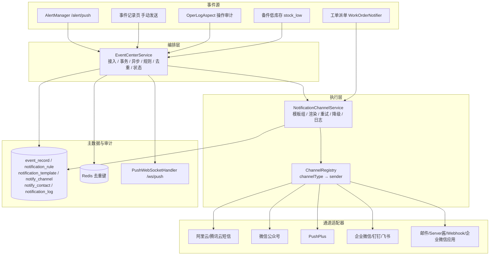
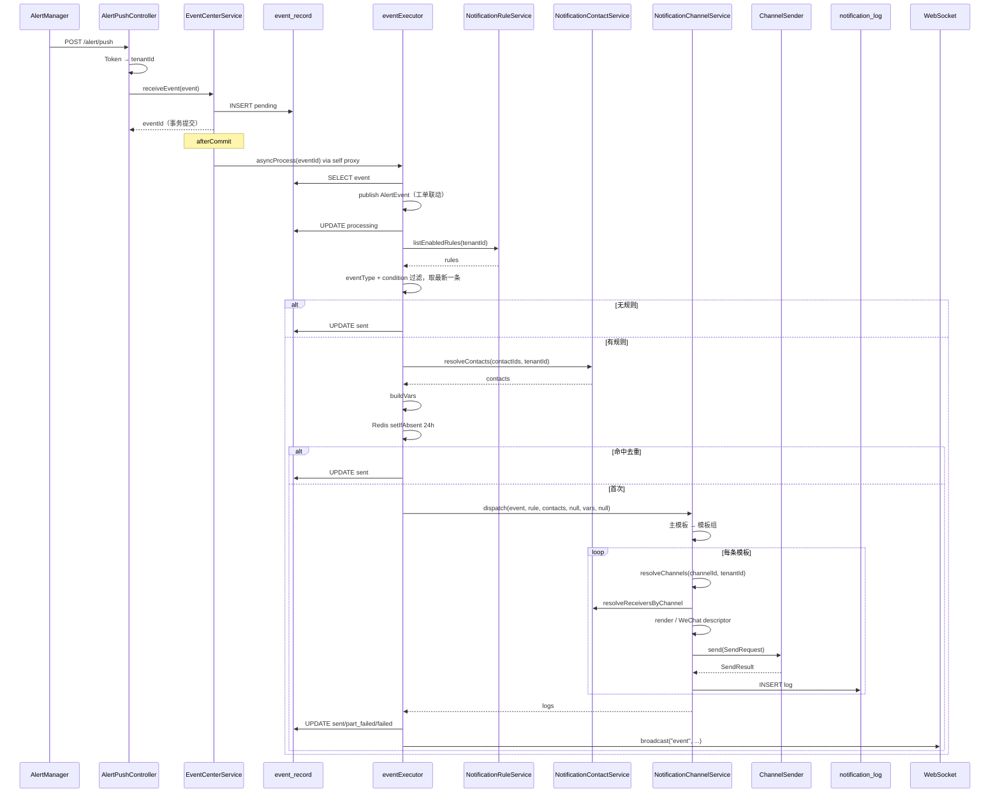
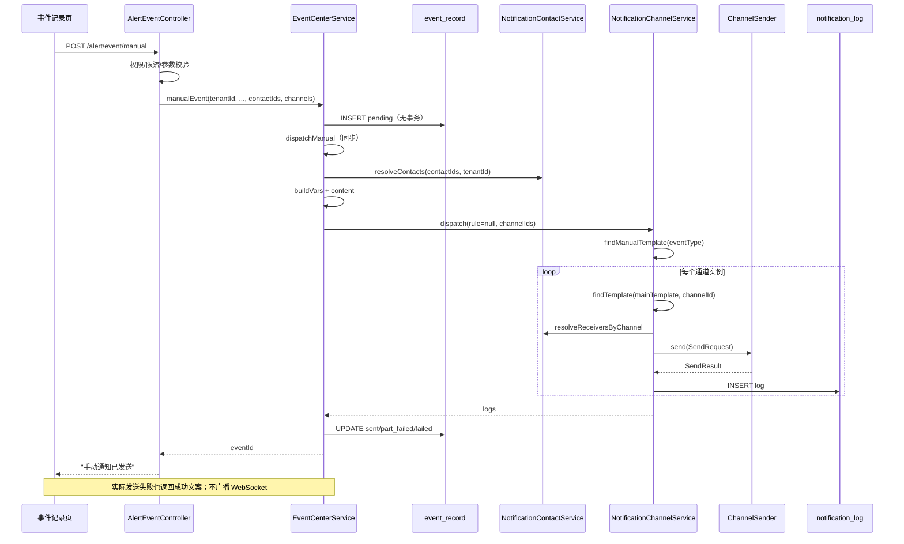
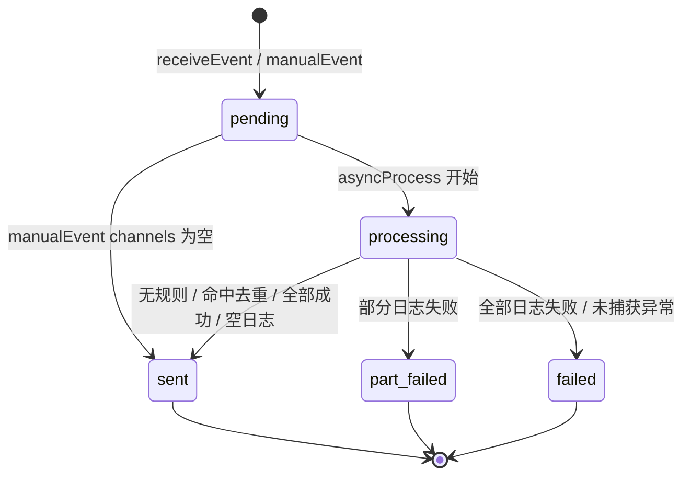

# EventCenterService 深度解析：事件编排层与告警通知全链路

> 适用基线：`feature/wechat-mp-full-support`，HEAD `ff40c2e`。  
> 代码根目录：`netsight-server/src/main/java/com/netsight/`。  
> 本文以静态代码阅读为主，结合前端页面与表结构核对；未在生产/测试环境重新发起真实告警。  
> 文中“代码观察/风险”是阅读结论，不代表已经修复；是否成立仍需按对应场景实测。  
> 本文不替代 `docs/NetSight-告警中心-消息通知全链路说明-20261116.md`：那篇偏业务全链路，本篇偏类级实现、参数传递、注解与通道差异。

---

## 阅读导航

- 0 结论：类定位与三层架构
- 1 类级结构：注解、依赖、常量
- 2 方法全景表
- 3 逐个方法深挖
- 4 注解体系：类、方法、参数、实体、控制器
- 5 前端页面与系统环节映射
- 6 告警中心各子模块的协作关系
- 7 自动通知全链路
- 8 手动通知完整时序
- 9 通道中心：模板、渲染、重试、降级、日志
- 10 11 类通道的发送过程与差异
- 11 参数传递全景
- 12 代码观察与风险清单
- 13 状态机与关键键值附录
- 14 排障手册
- 15 三句话版本
- 16 关键代码位置
- 17 结语

---

## 0. 先给结论：这个类到底在系统里干什么

`EventCenterService` 不是“发短信/发微信”的类，它是**告警事件编排层**。

用一句话概括：

> 把来自 AlertManager、手工操作、业务模块的事件统一落库，在事务提交后异步做租户内规则匹配、条件过滤、去重，然后把“发什么、发给谁、用哪个模板、走哪个通道实例”交给 `NotificationChannelService`，最后回写事件状态并广播 WebSocket。

它负责的是**流程编排和状态机**，不负责具体协议。真正的短信、微信公众号、企业微信、钉钉、飞书、邮件、PushPlus、Server酱、Webhook 发送，在 `NotificationChannelService` 之后的 `NotificationChannelSender` 实现里。



这里有一个很重要的架构判断：

- **自动通知**：`EventCenterService.receiveEvent` → `asyncProcess` → `NotificationChannelService.dispatch`，规则绑定的模板组决定通道。
- **手动通知**：`EventCenterService.manualEvent` → `dispatchManual` → `NotificationChannelService.dispatch`，前端传入的通道实例 ID 决定通道。
- **工单派单通知**：`WorkOrderNotifier` 自己构造临时事件和临时规则，直接调 `NotificationChannelService.dispatch`，**不经过** `EventCenterService`，也不落 `event_record`。
- **业务联动**：`asyncProcess` 在通知之前发布 `AlertEvent`，`WorkOrderEventListener` 据此自动建单/归档。

---

## 1. 类级结构：注解、依赖、常量

### 1.1 类注解

```java
@Slf4j
@Service
@RequiredArgsConstructor
public class EventCenterService
```

| 注解 | 作用 | 对本类的实际影响 |
|---|---|---|
| `@Slf4j` | Lombok 编译期生成 `private static final Logger log` | 所有日志走 `com.netsight.modules.alert.service.EventCenterService` 这个 logger；不是 Spring 注解 |
| `@Service` | Spring  stereotype，注册为容器 Bean | Bean 名称默认 `eventCenterService`；可被 `AlertPushService`、`AlertEventController`、`OperLogAspect`、`SparePartService` 注入 |
| `@RequiredArgsConstructor` | Lombok 为所有 `final` 字段生成构造器 | Spring 4.3+ 单构造器自动注入，不需要逐个写 `@Autowired`；单元测试可直接 `new EventCenterService(...)` |

类上**没有** `@Transactional`。这是有意的：类里既有短事务的 `receiveEvent`，也有完全不能包事务的 `asyncProcess`（里面要发 HTTP、睡眠重试），还有只读分页方法。事务边界放在方法级，避免长事务占连接。

### 1.2 十个依赖字段

```java
private final EventRecordMapper eventMapper;
private final NotificationRuleService ruleService;
private final NotificationChannelService channelService;
private final NotificationLogService logService;
private final StringRedisTemplate redisTemplate;
private final ApplicationEventPublisher eventPublisher;
private final ObjectMapper objectMapper;
private final SysTenantMapper tenantMapper;
private final NotificationContactService contactService;
private final ObjectProvider<EventCenterService> selfProvider;
```

| 字段 | 类型 | 在流程中的角色 |
|---|---|---|
| `eventMapper` | MyBatis-Plus Mapper | `event_record` 插入、按 ID 查、状态回写、分页 |
| `ruleService` | 领域服务 | 查启用规则、解析 `conditionJson`、`contactIds`、`channelsJson` |
| `channelService` | 发送执行层 | 模板组/手动通道分发、渲染、重试、日志落库 |
| `logService` | 领域服务 | 事件列表批量统计 `logCount` |
| `redisTemplate` | Redis 客户端 | 24h 去重键、恢复时删键 |
| `eventPublisher` | Spring 事件发布器 | 发布 `AlertEvent`，触发工单联动 |
| `objectMapper` | Jackson | 解析 `labelsJson` |
| `tenantMapper` | Mapper | 按租户 ID 查 `tenant_name` |
| `contactService` | 领域服务 | 按联系人 ID 查启用联系人 |
| `selfProvider` | `ObjectProvider<EventCenterService>` | **拿到自己的 Spring 代理**，保证 `asyncProcess` 的 `@Async` 生效 |

这十个字段都没有 `@Autowired`、`@Resource`、`@Value` 注解。注入方式完全由 `@RequiredArgsConstructor` 生成的构造器完成：Spring 发现只有一个构造器，就按参数类型从容器取 Bean。`selfProvider` 也是构造器参数，`ObjectProvider` 允许延迟到真正调用时才解析自身代理，避免构造期的循环引用问题。

`selfProvider` 是这类代码里最容易讲错的地方，后面 3.1 会单独展开。

### 1.3 两个常量

```java
private static final String DEDUP_KEY_PREFIX = "netsight:event:dedup:";
private static final Duration DEDUP_TTL = Duration.ofHours(24);
```

- 去重键格式：`netsight:event:dedup:{bizId}:{eventType}`。
- 去重窗口：24 小时。
- 设计原因写在注释里：设备持续离线时 AlertManager 会周期性重复推送，早期 5 分钟窗口会导致每 5 分钟重发一次，触发 PushPlus 等第三方“相同内容/频率过快”风控；改为 24 小时后，持续离线只通知一次。
- 恢复事件会删除该设备的离线/外线去重键，试图实现“恢复后再离线可以再次通知”。但这里的键拼接与 `AlertPushService` 的 `bizId` 生成方式存在不一致，见 12.2。

---

## 2. 方法全景表

| 方法 | 可见性 | 事务/异步 | 输入 | 输出 | 主要职责 | 前端/系统入口 |
|---|---|---|---|---|---|---|
| `receiveEvent(EventRecord)` | public | `@Transactional(REQUIRES_NEW)` | 事件对象 | 事件 ID | 补默认值、入库、提交后触发异步 | `/alert/push`、`@Log` 审计、备件低库存 |
| `manualEvent(...)` | public | 无事务、同步 | 租户、事件类型、bizId、内容、联系人 ID、通道实例 ID | 事件 ID | 手工事件入库并同步发送 | 事件记录页“手动发送” |
| `asyncProcess(Long)` | public | `@Async("eventExecutor")` | 事件 ID | void | 规则、去重、分发、状态、广播 | 由 `receiveEvent` 触发 |
| `dispatchManual(...)` | private | 无 | 事件、联系人 ID、通道 ID、内容 | void | 手动路径的发送与状态回写 | `manualEvent` 内部 |
| `matchCondition(...)` | private | 无 | 规则、事件 | boolean | 条件 JSON 全等匹配 | `asyncProcess` |
| `conditionValue(...)` | private | 无 | 字段名、事件 | String | 从事件字段或 labels 取值 | `matchCondition` |
| `buildVars(...)` | private | 无 | 事件 | Map | 组装模板变量 | 自动/手动路径 |
| `resolveTenantName(...)` | private | 无 | 租户 ID | String | 查租户名，异常兜底空串 | `buildVars` |
| `markEvent(...)` | private | 无 | 事件 ID、状态、规则 ID/名 | void | 局部更新状态 | 各分支 |
| `pageEvent(...)` | public | 无 | 页码、页大小、类型、级别、状态 | `PageResult` | 事件列表 + 日志数 | `/alert/event/list` |
| `pageOperationLog(...)` | public | 无 | 页码、页大小、关键字 | `PageResult` | 操作日志列表 | `/alert/event/operation-log` |

---

## 3. 逐个方法深挖

### 3.1 `receiveEvent`：统一接入口，事务与异步的分界线

```java
@Transactional(propagation = Propagation.REQUIRES_NEW, rollbackFor = Exception.class)
public Long receiveEvent(EventRecord event)
```

#### 3.1.1 入参和返回值

- 入参 `EventRecord event`：一个可变 POJO。调用方负责填 `tenantId / eventType / eventSource / severity / bizId / 设备字段 / labelsJson / content` 等。
- 返回 `Long eventId`：插入后由 MyBatis-Plus 回填到 `event` 对象的自增主键，同时作为返回值。
- `event` 对象在方法内会被**原地修改**：补租户、补状态、补重试次数，插入后补 ID、创建/更新时间。调用方之后仍能看到这些值。

#### 3.1.2 方法内参数传递与分支

1. **租户兜底**

   ```java
   if (event.getTenantId() == null) event.setTenantId(1L);
   ```

   这是“默认租户 1”的兜底。正常入口都会显式赋值：`AlertPushController` 解析 Token 得到租户，`AlertEventController` 取 `SecurityUtils.getTenantId()`，`OperLogAspect` 未登录也兜底 1，`SparePartService` 用备件所属租户。兜底本身是防御性的，但也意味着**任何忘记传租户的调用都会被静默归到租户 1**，排障时要先确认 `event_record.tenant_id`。

2. **事件类型校验**

   ```java
   if (!StringUtils.hasText(event.getEventType())) {
       throw new ServiceException(ResultCode.PARAM_ERROR);
   }
   ```

   `event_type` 是事件路由的第一键，空值没有意义。这里抛业务异常，`rollbackFor=Exception.class` 会让本次新事务回滚。

3. **状态与重试次数默认值**

   ```java
   if (event.getStatus() == null) event.setStatus("pending");
   if (event.getRetryCount() == null) event.setRetryCount(0);
   ```

   事件状态机从 `pending` 开始。`retryCount` 目前只写 0，后续没有任何地方递增，属于“预留字段”。

4. **插入**

   ```java
   eventMapper.insert(event);
   Long eventId = event.getId();
   ```

   MyBatis-Plus 的 `BaseEntity` 会处理：
   - `@TableId(AUTO)`：自增主键回填；
   - `@TableField(fill=INSERT)`：`createTime`；
   - `@TableField(fill=INSERT_UPDATE)`：`updateTime`；
   - `@TableLogic` + `select=false`：`delFlag` 逻辑删除字段，查询不返回。

5. **注册“提交后异步”回调**

   ```java
   Runnable dispatch = () -> selfProvider.getObject().asyncProcess(eventId);
   if (TransactionSynchronizationManager.isSynchronizationActive()) {
       TransactionSynchronizationManager.registerSynchronization(new TransactionSynchronization() {
           @Override public void afterCommit() { dispatch.run(); }
       });
   } else {
       dispatch.run();
   }
   ```

   这段是整条链路的**并发正确性核心**。

   - `REQUIRES_NEW`：如果调用方本身在一个业务事务里（例如工单派单、备件入库），`receiveEvent` 会挂起外层事务，自己开一个新事务。方法返回时新事务已经提交，外层事务后面即使回滚，事件也不会回滚。这正是“业务失败不能丢事件”的需求。
   - 为什么必须 `afterCommit`：`REQUIRES_NEW` 的提交发生在方法返回时。如果方法体里直接调异步，异步线程可能先 `selectById`，此时新事务还没提交，读不到事件，方法直接 `return`，事件永远停在 `pending`。注册 `afterCommit` 把“提交”与“投递异步任务”排成先后关系，消除这个竞态。
   - 为什么用 `selfProvider.getObject()`：`@Async` 是 Spring AOP 代理实现的。类内部 `this.asyncProcess(...)` 是自调用，不经过代理，`@Async` 不会生效，会变成同步执行，`/alert/push` 就会被短信/微信重试拖住。`ObjectProvider` 延迟拿到当前 Bean 的代理对象，再调用，才会进入 `eventExecutor` 线程池。
   - 无事务同步时直接执行：如果调用方没有事务，`isSynchronizationActive()` 为 false，此时插入已自动提交，直接投递异步任务是安全的。

#### 3.1.3 事务边界与失败模式

| 场景 | 行为 |
|---|---|
| 正常 HTTP 调用 | 插入提交 → afterCommit → 投递异步 → 立即返回事件 ID |
| 外层业务事务调用 | 挂起外层，内层新事务提交 → afterCommit 投递 → 外层继续 |
| 插入失败/类型为空 | 新事务回滚，异常抛给调用方 |
| 提交成功、JVM 在 afterCommit 前崩溃 | 事件已落库但没有任何异步任务，永久 `pending`；当前没有补偿扫描任务 |
| 线程池队列满 | `CallerRunsPolicy` 让调用线程自己跑 `asyncProcess`，`/alert/push` 会被同步阻塞，见 11.4 |
| `selfProvider.getObject()` 异常 | afterCommit 中的异常不会回滚已提交事务，事件留在 `pending` |

> 代码观察：`receiveEvent` 没有“同一 bizId 只插一条”的数据库唯一约束或抢占锁。AlertManager 重试会插入重复事件行，后续只靠 Redis 去重抑制通知；而 `AlertEvent` 是在去重之前发布的，重复事件仍会触发工单监听器。是否造成重复工单，取决于 `WorkOrderService.autoCreateFromEvent` 自身的幂等逻辑。

---

### 3.2 `manualEvent`：管理员主动发送，同步且不去重

```java
public Long manualEvent(Long tenantId, String eventType, String bizId, String content,
                        List<Long> contactIds, List<Long> channels)
```

#### 3.2.1 参数含义

| 参数 | 来源 | 说明 |
|---|---|---|
| `tenantId` | `SecurityUtils.getTenantId()` | 当前登录租户；超管也用自己的租户上下文 |
| `eventType` | 前端 body，默认 `manual_notify` | 决定 `findManualTemplate` 用哪个模板编码 |
| `bizId` | 前端可选 | 可为空；为空时微信 sender 会判定为“手工发送”，跳过 Redis 去重锁 |
| `content` | 前端 textarea | 手动正文；无模板时作为最终内容 |
| `contactIds` | 前端联系人多选 | 只传 ID，服务端再查实体并按通道解析地址 |
| `channels` | 前端渠道实例多选 | `notify_channel.id` 列表，不是通道类型字符串 |

#### 3.2.2 方法内流程

1. 构造 `EventRecord`：
   - `eventSource = "manual"`；
   - `severity = "info"`；
   - `status = "pending"`；
   - `retryCount = 0`；
   - 设备字段、`labelsJson` 都为空。
2. `eventMapper.insert(event)`：**没有** `@Transactional`，依赖 MyBatis-Plus 的自动提交；插入后 ID 回填。
3. `dispatchManual(event, contactIds, channels, content)`：同步执行。
4. 返回事件 ID。

#### 3.2.3 关键语义

- **不查规则**：手动发送不受 `notification_rule` 的 `eventType/condition` 限制。
- **不参与事件中心 24h 去重**：`manualEvent` 不碰 `netsight:event:dedup:*`。
- **但通道层仍可能去重**：微信公众号 sender 的 `manualSend = !hasText(bizId)`。如果前端填了 `bizId`，`manualSend=false`，仍会走微信的 Redis 锁和 24h 去重。因此“手动发送不去重”只在事件中心层成立。
- **同步阻塞 HTTP**：`manualEvent` 直接调用发送，Controller 要等所有通道发送、重试、降级完成才返回。短信重试默认 1s/2s/3s，多通道叠加时响应可能达到数秒到十几秒。
- **返回值不代表发送成功**：`dispatchManual` 内部捕获异常并只把事件标记为 `failed`，`manualEvent` 仍返回事件 ID；Controller 仍返回 `R.ok("手动通知已发送", eventId)`。前端看到“已发送”，实际可能全部失败。需要看 `event_record.status` 和 `notification_log`。
- **手动不发 WebSocket**：`dispatchManual` 没有 `PushWebSocketHandler.broadcast`，所以驾驶舱不会因为手动发送而实时刷新。
- **手动不发布 `AlertEvent`**：不会触发工单自动建单/归档。

---

### 3.3 `asyncProcess`：整条自动通知链路的主干

```java
@Async("eventExecutor")
public void asyncProcess(Long eventId)
```

入参只有 `eventId`。这是刻意的：**跨线程只传 ID，不传对象**。异步线程重新 `selectById`，拿到的是数据库里的最终状态，避免把调用线程里可能还被修改的对象带过来。

#### 3.3.1 步骤 0：发布 `AlertEvent`（业务联动）

```java
eventPublisher.publishEvent(new AlertEvent(event));
```

- `ApplicationEventPublisher` 默认是**同步**发布；`WorkOrderEventListener` 的 `@EventListener` 没有 `@Async`，所以工单联动就在 `event-exec-*` 线程里执行。
- `device_offline / device_line_abnormal` → `autoCreateFromEvent`；`device_recovered` → `handleRecover`。
- 监听器自己 `try/catch`，异常只记录，不影响后面的通知。
- 这一步在去重**之前**。也就是说，重复告警即使后面被 Redis 去重，工单联动仍会执行。是否重复建单由工单服务自己保证。

#### 3.3.2 步骤 0.5：设备恢复清去重键

```java
if ("device_recovered".equals(event.getEventType()) && hasText(event.getBizId())) {
    redisTemplate.delete(DEDUP_KEY_PREFIX + event.getBizId() + ":device_offline");
    redisTemplate.delete(DEDUP_KEY_PREFIX + event.getBizId() + ":device_line_abnormal");
}
```

意图：设备恢复后，把“离线已通知”和“外线异常已通知”的键删掉，下一次再离线可以重新通知。

但 `AlertPushService` 生成的 `bizId` 带状态前缀：

```java
return status + "_" + Math.abs(fingerprint.hashCode());
```

- 告警时：`firing_123456`
- 恢复时：`resolved_123456`

离线去重键是 `netsight:event:dedup:firing_123456:device_offline`，恢复时删除的是 `netsight:event:dedup:resolved_123456:device_offline`。**两者不相等，删不到**。所以走 AlertManager 原生报文时，“恢复后再离线”的去重键不会被清除，仍会被 24h 窗口压制；除非标准格式显式传了稳定的 `biz_id`。

#### 3.3.3 步骤 1：置 `processing`

```java
EventRecord update = new EventRecord();
update.setId(eventId);
update.setStatus("processing");
eventMapper.updateById(update);
```

这是状态机的中间态。注意没有事务包裹，更新立即提交；如果后续进程崩溃，事件会停在 `processing`，当前没有超时补偿。

#### 3.3.4 步骤 2：规则匹配

```java
List<NotificationRule> rules = ruleService.listEnabledRules(event.getTenantId());
List<NotificationRule> matched = rules.stream()
        .filter(r -> event.getEventType().equals(r.getEventType()))
        .filter(r -> matchCondition(r, event))
        .toList();
```

- `listEnabledRules` 的 SQL 条件是 `enabled=1 + tenant_id=事件租户 + order by id desc`。
- 先按 `event_type` **精确字符串相等**过滤，再按 `conditionJson` 过滤。
- `matched.get(0)` 只取**最新一条**规则。也就是说同一事件类型配置了多条规则时，只有 ID 最大的那条会执行，不是“全部规则依次执行”。这是当前产品语义，不是广播。
- 如果没有匹配：
  ```java
  markEvent(eventId, "sent", null, null);
  return;
  ```
  事件标记 `sent`，但不发任何通知，也不广播 WebSocket。`sent` 在这里表示“已受理、无需发送”，不是“已送达”。

#### 3.3.5 步骤 3：联系人解析

```java
List<Long> contactIds = ruleService.parseContactIds(rule);
List<NotificationContact> contacts = contactService.resolveContacts(contactIds, event.getTenantId());
```

- `parseContactIds` 读 `receiver_strategy_json` 里的 `contactIds` 数组；旧字段 `receivers`（手机号）不再参与。
- `resolveContacts` 条件：`id in (...) + tenant_id=事件租户 + status=1`。
- 为什么显式带 `tenantId`：异步线程没有 `SecurityContext`，MyBatis-Plus 租户拦截器会 `ignoreTable=true`，不会自动拼 `tenant_id`。这一点在 4.4 详述。
- 找不到联系人不会报错，返回空列表；后续按通道解析出空接收人，sender 可能直接失败或“无接收人成功”。

#### 3.3.6 步骤 4：组装模板变量

```java
Map<String, Object> vars = buildVars(event);
```

详见 3.6。要点：只放事件字段、租户名、时间、labels；**不放 `event.content`，也不解析 `contentVarsJson`**。

#### 3.3.7 步骤 5：Redis 去重

```java
if (hasText(event.getBizId())) {
    String dedupKey = DEDUP_KEY_PREFIX + event.getBizId() + ":" + event.getEventType();
    Boolean first = redisTemplate.opsForValue().setIfAbsent(dedupKey, "1", DEDUP_TTL);
    deduped = first != null && !first;
}
if (deduped) {
    markEvent(eventId, "sent", rule.getId(), rule.getRuleName());
    return;
}
```

- 只有 `bizId` 非空才去重。没有 `bizId` 的事件每次都发。
- `setIfAbsent` 是原子抢占；返回 `false` 表示键已存在。
- 命中去重后事件标记 `sent`，并写入命中的规则 ID/名称，但不发送、不广播。
- Redis 异常没有被单独捕获；会落到外层 `catch`，事件被标记 `failed`，**一条通知都不会发**。这意味着 Redis 不可用时自动通知整体不可用，不是“降级为不去重”。
- 日志文案仍写“5分钟内已发送”，与 24h 常量不一致，属于历史文案残留。

#### 3.3.8 步骤 6：分发

```java
List<NotificationLog> logs = channelService.dispatch(event, rule, contacts, null, vars, null);
```

- `rule != null && rule.templateId != null` → `dispatchByTemplateGroup`（模板组决定通道）。
- 否则 → `dispatchByChannelIds(event, contacts, null, ...)`；这里 `channelIds` 传的是 `null`，所以如果规则 `templateId` 为空，会直接返回空日志，事件最终被判 `sent`。**规则只配了事件类型、没配模板时，不会发送，也不会报错。**
- `rule.channelsJson` 在自动路径已经完全不再参与路由。前端规则页也不再让用户选通道，改为选模板组。

#### 3.3.9 步骤 7：状态聚合

```java
long failCount = logs.stream().filter(l -> l.getSuccess().equals(0)).count();
String status = failCount == 0 ? "sent" : (failCount == logs.size() ? "failed" : "part_failed");
markEvent(eventId, status, rule.getId(), rule.getRuleName());
```

| 条件 | 状态 | 含义 |
|---|---|---|
| `logs` 为空 | `sent` | 没有实际发送尝试，却被判“已发送” |
| 全部成功 | `sent` | 所有通道日志 success=1 |
| 全部失败 | `failed` | 所有日志 success=0 |
| 部分失败 | `part_failed` | 至少一条成功、至少一条失败 |

`logs` 为空的情况包括：
- 模板不属于事件租户；
- 模板组没有启用模板；
- 模板没有 `channelId`；
- 通道实例被禁用；
- 规则 `templateId` 为空；
- 规则没有匹配到（这条分支提前 return，不会到这里）。

这是可观测性上的一个硬伤：**“什么都没发”和“全部发成功”共用 `sent`**。

#### 3.3.10 步骤 8：WebSocket 广播

```java
PushWebSocketHandler.broadcast("event", Map.of(
    "eventId", eventId, "eventType", event.getEventType(),
    "severity", ..., "deviceName", ..., "deviceIp", ...,
    "status", status, "content", ...));
```

- 只在真正走到分发并回写状态后广播。
- 无规则、命中去重、手动发送都不会广播。
- `PushWebSocketHandler` 是静态 `CopyOnWriteArraySet`，向所有在线会话广播，没有按租户过滤。多租户环境下，A 租户的浏览器会收到 B 租户的事件元数据（事件 ID、类型、级别、设备名、IP、正文）。见 12.6。
- 前端 `/ws/push` 消息格式是 `{"type":"event","data":{...},"time":"..."}`；驾驶舱监听 `event/device-status/order` 后调 `refreshAll()`。

#### 3.3.11 外层异常兜底

```java
catch (Exception e) {
    log.error(...);
    markEvent(eventId, "failed", null, null);
}
```

任何未捕获异常（Redis、规则解析、通道解析、日志落库等）都会把事件标成 `failed`，并清空规则信息（`null` 不更新，见 3.9）。没有死信队列，也没有自动重试。

---

### 3.4 `dispatchManual`：手动路径的分发与状态

```java
private void dispatchManual(EventRecord event, List<Long> contactIds, List<Long> channels, String content)
```

流程：

1. `channels` 为空 → `markEvent(sent)` 直接返回。
2. `contactService.resolveContacts(contactIds, tenantId)` 查联系人。
3. `buildVars(event)` + `vars.put("content", content)`。
4. `channelService.dispatch(event, null, contacts, channels, vars, null)`。
   - `rule=null`，所以走 `dispatchByChannelIds`。
5. 聚合成功/失败数，`markEvent(status, null, null)`。
6. 任何异常 → `failed`。

参数传递要点：

- `content` 不只用于“无模板兜底”，还作为变量 `content` 注入 `vars`。模板里写 `{{content}}` 时，手动路径能渲染出正文；自动路径不能，因为 `buildVars` 没有放 `content`。
- `channels` 是 `notify_channel.id`，由前端渠道多选框传入；Controller 还会逐个 `selectById` 判断是否包含 `pushplus`，用于决定“联系人为空是否允许”。
- 手动路径的所有通道共用同一个 `mainTemplate`（由 `findManualTemplate` 按事件类型找到的第一条启用模板），但每个通道会用 `findTemplate` 再找该通道实例专属模板；找不到就用 `mainTemplate.content` 兜底。

---

### 3.5 `matchCondition` / `conditionValue`：条件匹配的真实规则

#### 3.5.1 `matchCondition`

```java
Map<String, Object> condition = ruleService.parseCondition(rule);
if (condition == null || condition.isEmpty()) return true;
for (entry : condition.entrySet()) {
    String expected = String.valueOf(entry.getValue());
    String actual = conditionValue(entry.getKey(), event);
    if (!expected.equals(actual)) return false;
}
return true;
```

- 空条件、`null`、JSON 解析失败都返回**空 Map → 全部匹配**。`parseCondition` 内部 `catch` 后返回 `Map.of()`，所以一条写坏的 `conditionJson` 不会“拒绝所有”，而是“放行所有”。这是一个容易埋雷的宽松策略。
- 多个条件之间是 **AND**。
- 比较是**字符串严格相等**，没有 `>`、`<`、`in`、正则、大小写忽略。
- 数字型条件要写成 `"5"` 才能匹配 `String.valueOf(5)`；布尔同理。
- key 大小写敏感。

#### 3.5.2 `conditionValue`

| 字段 | 取值来源 |
|---|---|
| `severity` | `event.severity` |
| `device_type` | `event.deviceType` |
| `device_ip` | `event.deviceIp` |
| `event_source` | `event.eventSource` |
| 其他 | `labels_json` 里的同名字段；解析失败/不存在返回 `""` |

注意：`buildVars` 的优先级是“事件字段优先，labels 只补缺失”，而 `conditionValue` 对上述四个字段**只读事件字段**，不会回退 labels。如果事件字段为空、但 labels 里有 `severity`，条件匹配会得到空串，渲染却可能拿到 labels 值。两者语义不完全对称。

---

### 3.6 `buildVars`：模板变量到底有哪些

```java
Map<String, Object> vars = new HashMap<>();
vars.put("device_name", ...);
vars.put("device_ip", ...);
vars.put("device_type", ...);
vars.put("location", ...);
vars.put("device_location", ...);
vars.put("severity", ...);
vars.put("event_type", ...);
vars.put("biz_id", ...);
vars.put("tenant_name", resolveTenantName(...));
vars.put("time", event.getCreateTime() == null ? "" : format(...));
// labels 合并
labels.forEach(vars::putIfAbsent);
```

| 变量 | 来源 | 说明 |
|---|---|---|
| `device_name` | `event.deviceName` | 空转 `""` |
| `device_ip` | `event.deviceIp` | 空转 `""` |
| `device_type` | `event.deviceType` | 空转 `""` |
| `location` | `event.location` | 空转 `""` |
| `device_location` | `event.location` | 兼容历史模板 |
| `severity` | `event.severity` | 原始值，如 `critical` |
| `event_type` | `event.eventType` | 事件类型 |
| `biz_id` | `event.bizId` | 去重/追溯 |
| `tenant_name` | `sys_tenant.tenant_name` | 每次事件一次查询，异常兜底空串 |
| `time` | `event.createTime` | `yyyy-MM-dd HH:mm:ss`，事件入库时间，不是发送时间 |
| labels 中的键 | `event.labelsJson` | 只在 `vars` 不存在同名键时补入；事件字段优先 |

**没有注入的变量：**

- `content`：自动路径不注入；手动路径由 `dispatchManual` 单独 `put`。
- `contentVarsJson`：`AlertPushService` 把 `content_vars` 写进了数据库，但 `buildVars` 完全没有解析它。标准格式报文里的 `content_vars` 除了 `device_name/device_ip/device_type/location` 被复制到实体字段外，其余变量在自动通知中丢失。
- `event_title`、`event_state`、`severity_text`、`device_no`：这些是微信公众号 sender 在 `WechatTemplatePayload.enrich` 里补的，不是 `buildVars` 的产物。其他通道拿不到这些变量。
- `part_name/part_no/quantity/unit/safe_stock` 等：备件事件是通过 `labelsJson` 注入的，能进 `vars`。

`HashMap` 的迭代顺序不稳定。腾讯云短信 sender 直接把 `contentVars.values()` 按迭代顺序转数组，模板参数顺序不可控，见 12.5。

---

### 3.7 `resolveTenantName`

```java
SysTenant tenant = tenantMapper.selectById(tenantId);
return tenant == null ? "" : nullToEmpty(tenant.getTenantName());
```

- `sys_tenant` 在 `MybatisPlusConfig.IGNORE_TABLES` 里，不受租户拦截器影响，所以异步线程也能查。
- 异常只 warning，不阻断通知。
- 每个事件都会查一次；批量告警时有 N 次小查询，但量级可接受。

---

### 3.8 `markEvent`

```java
EventRecord update = new EventRecord();
update.setId(eventId);
update.setStatus(status);
update.setRuleId(ruleId);
update.setRuleName(ruleName);
eventMapper.updateById(update);
```

- 局部更新，不覆盖其他字段。
- MyBatis-Plus 默认 `updateStrategy=NOT_NULL`：`ruleId/ruleName` 为 `null` 时不会写库。所以“异常时传 null”并不能清空已有规则字段；不过当前每个事件只处理一次，且插入时规则字段本来为空，实际影响有限。
- `updateTime` 由 `MyMetaObjectHandler` 自动填充。
- 没有事务；多次 `markEvent` 是独立自动提交。

---

### 3.9 `pageEvent`：事件列表与日志数

```java
public PageResult<EventRecord> pageEvent(long pageNum, long pageSize,
        String eventType, String severity, String status)
```

- 分页参数由 Controller 的 `@RequestParam(defaultValue="1"/"10")` 提供；全局分页插件 `maxLimit=500`。
- 动态条件：
  - `eventType` 非空 → `eq`；
  - `severity` 非空 → `eq`；
  - `status` 非空 → `eq`；
  - `eventType` 为空 → `ne(event_type, "user_operation")`，默认把操作日志排除。
- 租户：
  - 超管：不加租户条件，看全部；
  - 非超管：`tenant_id = SecurityUtils.getTenantId()`。
- 排序：`id desc`，最新事件在前。
- 日志数：
  ```java
  logs = logService.listByEventIds(eventIds);
  countMap.merge(eventId, 1L, Long::sum);
  ```
  一次批量查当前页事件的日志，避免逐行查库；把条数写入非表字段 `logCount`。
- 返回 `PageResult.of(total, records)`。

前端对应 `netsight-ui/src/views/alert/event/index.vue`：

- 列：事件 ID、类型、级别、设备名+IP、位置、规则名、日志数、状态、时间；
- 筛选：事件类型、级别、状态；
- “发送”列展示 `logCount`；
- 详情弹窗展示 `content`。

注意：`eventType` 显式传 `user_operation` 时，`ne` 不会追加，所以事件页也能查出操作日志；这是“显式指定优先”的行为，不是 bug。

---

### 3.10 `pageOperationLog`：操作日志专用查询

```java
public PageResult<EventRecord> pageOperationLog(long pageNum, long pageSize, String keyword)
```

- 固定 `event_type = 'user_operation'`。
- 关键字 OR 模糊匹配三列：
  - `device_name`（模块名）；
  - `content`（操作内容）；
  - `location`（URI）。
- 非超管加 `tenant_id`；超管看全部。
- `id desc`。
- 不做日志数统计。

操作日志的数据来源是 `OperLogAspect.record`：

- `eventType = user_operation`；
- `eventSource = system`；
- `severity = info`；
- `deviceName = @Log.module`；
- `deviceIp = 客户端 IP`；
- `location = requestURI`；
- `content = 操作人/动作/参数/IP/结果/耗时`；
- `labelsJson` 里还有 `operator/module/action/method/uri/ip/result/costTime`。

对应前端 `alert/operation-log/index.vue`，接口 `GET /alert/event/operation-log`。

---

## 4. 注解体系：类、方法、参数、实体、控制器

### 4.1 类与方法注解

| 注解 | 位置 | 目的 | 生效方式/坑 |
|---|---|---|---|
| `@Slf4j` | 类 | 生成 logger | Lombok 编译期；不产生 Bean |
| `@Service` | 类 | 注册服务 Bean | 组件扫描；默认单例 |
| `@RequiredArgsConstructor` | 类 | 为 `final` 字段生成构造器 | 单构造器自动注入；测试友好 |
| `@Transactional(propagation=REQUIRES_NEW, rollbackFor=Exception.class)` | `receiveEvent` | 开独立事务，任何异常回滚 | 必须经 Spring 代理调用；同类自调用不生效。`REQUIRES_NEW` 会挂起外层事务，注意数据库连接占用 |
| `@Async("eventExecutor")` | `asyncProcess` | 提交到指定线程池 | 必须经代理调用；`void` 方法异常不会传回调用方；本方法内部已全捕获 |
| `@EventListener` | `WorkOrderEventListener.onAlertEvent` | 监听 `AlertEvent` | 默认同步；无 `@Async` 时在发布线程执行 |
| `@Scheduled(fixedDelay=300_000, initialDelay=60_000)` | `NotifyChannelService.healthCheck` | 每 5 分钟巡检通道 | 需要开启调度；多数 sender 的 `healthCheck` 恒 true，实际价值有限 |
| `@Value` | `NotificationChannelService.retryIntervals` / `fallbackEnabled` 等 | 注入配置 | 默认 `1000,2000,3000` / `true` |
| `@PostConstruct` | `AlertPushController.validateWebhookToken`、`PushplusChannelSender.init` | 启动校验/告警 | 生产未配 `WEBHOOK_TOKEN` 直接拒启动 |

`@Transactional` 的传播行为补充：

- `REQUIRES_NEW`：不管外层有没有事务，都新开一个；外层挂起。适合“事件必须落库”的场景。
- `rollbackFor=Exception.class`：默认 Spring 只对 `RuntimeException`/`Error` 回滚，显式写 `Exception` 才能让受检异常也回滚。
- 事务只覆盖 `receiveEvent` 的插入，不覆盖异步处理；异步里的多次更新/日志插入各自自动提交，不是一个大事务。

`@Async` 的返回类型：

- 这里返回 `void`。调用方拿不到结果；方法内部异常被 `try/catch` 吞掉并写 `failed`。
- 如果未来改成 `Future/CompletableFuture`，调用方才能拿到异常；但也会改变“提交后即返回”的语义。

### 4.2 方法参数上的注解

`EventCenterService` 的方法参数**没有** Spring Web 注解。它只接收普通 Java 对象/ID。参数绑定发生在 Controller 层：

| Controller 参数注解 | 例子 | 作用 |
|---|---|---|
| `@RequestBody` | `manual(@RequestBody Map<String,Object> body)` | 整个 JSON body 映射为 Map |
| `@RequestParam` | `list(@RequestParam(defaultValue="1") long pageNum, ...)` | query string 绑定，可设默认值/必填 |
| `@RequestHeader` | `push(@RequestHeader("X-Netsight-Webhook-Token") String token, ...)` | 请求头绑定，`required=false` 表示可缺省 |
| `@PathVariable` | 本模块手动/事件接口未使用 | 路径变量绑定 |
| `@PreAuthorize` | `hasRole('super_admin') or hasAuthority('alert:event:list')` | Spring Security 方法级权限 |
| `@Log` | `@Log(module="告警中心", action="手动发送告警")` | 自定义审计切面，成功后写 `user_operation` 事件 |
| `@RateLimit(key="ip", limit=20, window=60)` | 手动发送 | 自定义限流切面，按 IP 20 次/60 秒 |

### 4.3 实体注解

以 `EventRecord` / `BaseEntity` 为例：

| 注解 | 位置 | 目的 |
|---|---|---|
| `@Data` | 实体类 | Lombok 生成 getter/setter/equals/hashCode/toString |
| `@EqualsAndHashCode(callSuper=true)` | 实体类 | equals/hashCode 把父类字段也算进去 |
| `@TableName("event_record")` | 实体类 | 指定表名 |
| `@TableId(type=AUTO)` | `BaseEntity.id` | 自增主键，插入后回填 |
| `@TableField(fill=INSERT)` | `createTime` | 插入时自动填当前时间 |
| `@TableField(fill=INSERT_UPDATE)` | `updateTime` | 插入/更新都填当前时间 |
| `@TableLogic` | `delFlag` | 逻辑删除；删除变更新，查询自动过滤 |
| `@TableField(select=false)` | `delFlag` | 查询不返回该字段 |
| `@TableField(exist=false)` | `EventRecord.logCount` | 非表字段，仅用于列表回显 |
| `@Builder.Default` | `SendResult.retryable` | Builder 不显式设值时保留默认 `true` |

这些注解共同决定了：

- `eventMapper.insert(event)` 后 `event.getId()` 有值；
- `createTime/updateTime` 不需要业务代码赋值；
- `pageEvent` 查询不会带出 `del_flag`；
- `logCount` 不会被当成数据库列。

### 4.4 租户拦截器注解之外的“隐形规则”

`MybatisPlusConfig` 里的 `TenantLineInnerInterceptor` 不是注解，但它决定了所有 Mapper 的 SQL：

```java
public Expression getTenantId() { return new LongValue(SecurityUtils.getTenantId()); }

public boolean ignoreTable(String tableName) {
    if (!SecurityUtils.isAuthenticated()) return true;
    if (SecurityUtils.isSuperAdmin()) return true;
    return IGNORE_TABLES.contains(tableName);
}
```

关键推论：

1. **Web 请求、已登录、非超管**：自动拼 `tenant_id = 当前租户`。
2. **异步线程**：没有 `SecurityContext`，`isAuthenticated()` 为 false → `ignoreTable=true` → **所有表都不拼租户条件**。
3. **超管**：同样 `ignoreTable=true`，看全量。
4. `sys_tenant`、`sys_role`、`sys_permission`、Warm-Flow 表在 `IGNORE_TABLES` 里，永远不拼业务租户。

所以 `asyncProcess`、`dispatchByTemplateGroup`、`resolveContacts`、`findManualTemplate` 里到处显式 `.eq(tenantId)`，不是“重复劳动”，而是异步线程下唯一可靠的隔离手段。任何在异步链路里新写的查询，如果忘了显式租户，都会变成跨租户全表查。

---

## 5. 前端页面与系统环节映射

| 前端页面 | 路由/文件 | 调用的后端接口 | 与 `EventCenterService` 的关系 |
|---|---|---|---|
| 事件记录 | `views/alert/event/index.vue` | `GET /alert/event/list` | `pageEvent`；列表、筛选、日志数 |
| 事件记录-手动发送 | 同上，弹窗 | `POST /alert/event/manual` | `manualEvent` → `dispatchManual` |
| 操作日志 | `views/alert/operation-log/index.vue` | `GET /alert/event/operation-log` | `pageOperationLog` |
| 通知规则 | `views/alert/rule/index.vue` | `/alert/rule/list|add|update|delete` | 规则主数据；`asyncProcess` 读取 |
| 消息模板 | `views/alert/template/index.vue` | `/alert/template/list|options|...` | 模板组；`dispatchByTemplateGroup` 读取 |
| 渠道管理 | `views/alert/channel/index.vue` | `/alert/channel/meta|list|options|...` | 渠道实例；`resolveChannels` 解密配置 |
| 发送日志 | `views/alert/log/index.vue` | `GET /alert/log/list` | `NotificationChannelService` 写入的日志 |
| 通知联系人 | `views/alert/contact/index.vue` | `/alert/contact/list|options|...` | 联系人主数据；`resolveContacts` 读取 |
| 驾驶舱 | `views/dashboard/index.vue` | `listEvent` + `/ws/push` | 事件列表 + `event` 广播后 `refreshAll()` |
| 备件管理 | 备件页面 | 备件新增/出入库 | `SparePartService.checkLowStockAndNotify` → `stock_low` 事件 |
| 工单/H5 派单 | 工单详情/H5 | 工单派单接口 | `WorkOrderNotifier` 直接调通道中心，绕过事件中心 |
| 外部告警 | 无页面 | `POST /alert/push` | AlertManager → `AlertPushService` → `receiveEvent` |

### 5.1 手动发送弹窗的真实参数

前端 `alert/event/index.vue` 的手动发送：

- `content`：文本域；
- `contactIds`：联系人下拉多选；
- `channels`：渠道实例下拉多选，值是 `notify_channel.id`；
- 提交 body：
  ```json
  {
    "eventType": "manual_notify",
    "content": "...",
    "contactIds": [1, 2],
    "channels": [10, 11]
  }
  ```
- 仅当所选渠道**全部**是 `pushplus` 时，才允许不选联系人；Controller 的判断是“所选渠道中是否包含 pushplus”，只要包含一个 pushplus 就允许空联系人，这一点比前端更宽松。

`AlertEventController` 的注释仍写着 `channels:["sms","wechat","pushplus"]`，这是旧文档口径；实际 `castLongList` 解析为渠道实例 ID，前端也传 ID。

### 5.2 规则页的真实语义

规则页字段：

- `ruleName`；
- `eventType`；
- `conditionJson`：UI 只让选 `severity`，也可以不选；
- `templateId`：模板组下拉；
- `contactIds`：联系人多选；
- `enabled`。

页面提示“通道由模板自带：同模板组下多个通道实例自动全部发送”。这解释了为什么规则页没有通道多选：**通道绑定已经下沉到模板**。

### 5.3 方法级映射：每个方法落在哪个环节

| 方法 | 直接触发者 | 前端可见结果 | 系统环节 |
|---|---|---|---|
| `receiveEvent` | `/alert/push`、`@Log` 切面、备件服务 | 事件列表出现新记录（可能还是 `pending`） | 事件接入/落库 |
| `manualEvent` | 事件页“手动发送” | 事件列表新增 `manual` 事件；弹窗提示“已发送” | 手工补发/公告 |
| `asyncProcess` | `receiveEvent` 的 afterCommit | 状态从 `pending → processing → sent/part_failed/failed`；日志数增加 | 规则路由/发送编排 |
| `dispatchManual` | `manualEvent` | 发送日志页出现记录；事件状态同步回写 | 手动发送执行 |
| `matchCondition` | `asyncProcess` | 决定规则是否命中；不直接可见 | 条件过滤 |
| `conditionValue` | `matchCondition` | 决定条件取值；不直接可见 | 条件字段解析 |
| `buildVars` | `asyncProcess` / `dispatchManual` | 影响模板渲染结果 | 模板变量组装 |
| `resolveTenantName` | `buildVars` | 模板里的 `{{tenant_name}}` | 租户上下文补全 |
| `markEvent` | 各分支 | 事件状态/规则名变化 | 状态机回写 |
| `pageEvent` | `GET /alert/event/list` | 事件记录页表格/筛选/日志数 | 查询 |
| `pageOperationLog` | `GET /alert/event/operation-log` | 操作日志页表格 | 查询 |

---

## 6. 告警中心各子模块的协作关系

| 子模块 | 核心表 | 角色 | 与事件中心的关系 |
|---|---|---|---|
| 事件记录 | `event_record` | 事件总线/审计 | `receiveEvent` 写；`pageEvent` 读；状态机 |
| 通知规则 | `notification_rule` | 自动发送策略 | `asyncProcess` 按租户+类型+条件匹配；只取最新一条 |
| 消息模板 | `notification_template` | 内容 + 通道绑定 | 规则只绑一个主模板；同 `templateCode` 的多条模板组成“模板组”，每条绑一个通道实例 |
| 渠道管理 | `notify_channel` | 通道实例与密钥 | 模板的 `channelId` 指向它；`resolveChannels` 解密配置 |
| 通知联系人 | `notify_contact` | 收件人主数据 | 规则/手动传 ID；按通道解析 mobile/openid |
| 发送日志 | `notification_log` | 每次通道发送的审计 | 通道中心写；事件列表统计 `logCount` |
| 操作日志 | `event_record` 的 `user_operation` 子集 | 操作审计 | `OperLogAspect` → `receiveEvent`；单独页面查询 |
| 驾驶舱 | 无独立表 | 实时展示 | `pageEvent` + WebSocket `event` 广播 |
| 工单联动 | 工单表 | 业务闭环 | `AlertEvent` → 自动建单/归档；派单通知走旁路 |
| 租户/网关 | `sys_tenant` / `edge_gateway` | 凭证与密钥 | Webhook Token、PushPlus Token、租户名 |

### 6.1 “模板即通道”的主数据模型

这是当前版本最关键的设计变化：

```text
notification_rule
  └─ template_id ──► notification_template (主模板，只作为 templateCode 锚点)
                        └─ template_code = tpl_device_offline
                             ├─ 模板 A: channel_id = 短信实例 1
                             ├─ 模板 B: channel_id = 公众号实例 2
                             └─ 模板 C: channel_id = PushPlus 实例 3
```

- 规则只需要绑一个主模板；
- 发送时按主模板的 `templateCode` 查同租户、`enabled=1` 的全部模板；
- 每条模板通过 `channelId` 绑定具体通道实例；
- 遍历模板组逐条发送，从而达到“一条规则、多通道”。

这也解释了：

- `notification_template.channelId` 必须非空（`addTemplate/updateTemplate` 强制校验）；
- `channelType` 字段更多是展示/筛选/前端表单用，实际路由以通道实例的 `channelType` 为准；
- 同一 `templateCode + channelId` 唯一，同一通道实例不能在一个模板组里重复绑定；
- 规则里的 `channelsJson` 是历史字段，自动路径不再读取。

---

## 7. 自动通知全链路：从 AlertManager 到多通道

### 7.1 入口 A：AlertManager Webhook

```text
AlertManager
  POST /alert/push
  X-Netsight-Webhook-Token: <租户 Token 或全局 Token>
  X-Netsight-Tenant-Id: <过渡租户头>
        │
        ▼
AlertPushController.push
  ① webhookTokenService.resolveTenantId(token)
     Redis 缓存 → sys_tenant 全量解密比对 → 回填缓存
  ② 未命中租户 Token → 全局 token + Tenant-Id（缺省 1）
  ③ 都失败 → 401
        │
        ▼
AlertPushService.push(body, tenantId)
  - alerts[] 分支：逐条 buildFromAlertManager
  - event_type 分支：buildFromStandard
        │
        ▼
EventCenterService.receiveEvent(event)  // 每条事件独立 REQUIRES_NEW
```

`AlertPushService` 的映射规则：

| alertname / status | event_type |
|---|---|
| 网络设备离线故障 / 设备离线 | `device_offline` |
| 设备外线状态异常 / 外线异常 / 外线链路异常 | `device_line_abnormal` |
| 故障恢复 / 告警恢复 / `status=resolved` | `device_recovered` |
| CPU使用率过高 / CPU过高 | `device_cpu_high` |
| 内存使用率过高 / 内存过高 | `device_mem_high` |
| 未知 | 保留 alertname 原文 |

`bizId`：

```java
status + "_" + Math.abs((alertname + deviceIp + generatorURL).hashCode())
```

`labelsJson` 存原始 labels；`contentVarsJson` 存 labels+annotations；`content` 取 description/summary。

### 7.2 入口 B：手动发送

```text
alert/event/index.vue
  POST /alert/event/manual
        │
        ▼
AlertEventController.manual
  - @PreAuthorize alert:event:manual
  - @Log 写操作审计
  - @RateLimit 20/60s/IP
  - 校验 channels 非空、联系人或 pushplus
        │
        ▼
EventCenterService.manualEvent
  插入 event_record
        │
        ▼
dispatchManual（同步）
  resolveContacts → buildVars + content
        │
        ▼
NotificationChannelService.dispatch(rule=null, channelIds)
  → dispatchByChannelIds
```

### 7.3 入口 C：操作审计

```text
任意带 @Log 的 Controller 方法
  → OperLogAspect.record
  → EventRecord(event_type=user_operation)
  → receiveEvent
  → asyncProcess
  → 通常无匹配规则 → status=sent
```

这条链路的意义是“审计事件也走事件中心”，但默认没有规则，所以只落库不发送；事件列表默认排除 `user_operation`，操作日志页单独展示。

### 7.4 入口 D：备件低库存

```text
SparePartService.addPart / 出入库
  → checkLowStockAndNotify(part)
  → EventRecord(event_type=stock_low, bizId=stock_low:{partId}:{yyyy-MM-dd})
  → receiveEvent
```

- 条件：`safeStock > 0 && quantity <= safeStock`。
- `bizId` 按天，叠加事件中心 24h 去重，效果是“同一天同备件只提醒一次”。
- 变量通过 `labelsJson` 注入：`partName/part_no/partNo/quantity/unit/safeStock/safe_stock/location`。
- 有 `tpl_stock_low` 模板组时才会真正发送。

### 7.5 入口 E：工单派单（旁路）

```text
WorkOrderService.dispatch
  → afterCommit
  → WorkOrderNotifier.notifyRepairer(order, repairer)
  → 查 tpl_order_dispatch
  → 构造临时 NotificationRule（只设 templateId）
  → 构造临时 EventRecord（不插入 event_record）
  → 构造联系人（优先复用同手机号联系人，否则临时手机号）
  → channelService.dispatch(event, rule, contacts, null, vars, null)
```

这条链路：

- 不经过 `EventCenterService`；
- 不写 `event_record`；
- 因此 `notification_log.eventId` 为 `null`（临时事件没有 ID），在事件页看不到这些日志；
- 不参与事件中心去重；
- 模板组仍决定通道；
- 发送失败不会回滚工单（afterCommit 后执行）。

### 7.6 自动通知完整时序



---

## 8. 手动通知完整时序



---

## 9. 通道中心：模板、渲染、重试、降级、日志

### 9.1 `dispatch` 的两个分支

```java
if (rule != null && rule.getTemplateId() != null) {
    return dispatchByTemplateGroup(event, rule, contacts, vars, extra);
}
return dispatchByChannelIds(event, contacts, channelIds, vars, extra);
```

- 自动：`rule` 非空、`templateId` 非空 → 模板组。
- 手动：`rule=null` → 通道实例列表。
- 规则存在但 `templateId=null` → 走 `dispatchByChannelIds`，而 `channelIds` 传了 `null` → 空日志。

### 9.2 `dispatchByTemplateGroup` 细节

1. 按 `rule.templateId + event.tenantId` 查主模板；查不到 → warning + 空日志。
2. 按 `mainTemplate.templateCode + event.tenantId + enabled=1` 查模板组。
3. 遍历模板组：
   - `resolveChannelInstance(tpl, tenantId)`：`channelId` 为空直接跳过；`resolveChannels` 返回空则跳过。
   - `channelKey = channelType + "#" + channelId`；`doneChannelKeys` 防同一实例重复发送。
   - `resolveReceiversByChannel(contacts, channelType, appIdOf(ch))`。
   - `sendOneResolved`：直接使用当前模板，不 `findTemplate`。
4. 降级：短信类失败且 `fallbackEnabled`，在模板组里找第一个 `wechat_work` 模板，发一次。

### 9.3 `dispatchByChannelIds` 细节

1. `channelIds` 空 → 空日志。
2. `findManualTemplate(tenantId, eventType)`：按事件类型映射模板编码，取一条启用模板。
3. `resolveChannels(channelIds, tenantId)`：按传入顺序解析实例，不存在/跨租户抛异常，禁用跳过。
4. 遍历实例：
   - 同一个 `channelType#channelId` 去重；
   - `resolveReceiversByChannel`；
   - `sendOne`：每个实例用 `findTemplate(mainTemplate, channelType, channelId, tenantId)` 找该通道专属模板，找不到用主模板内容兜底。
5. 降级：短信失败且启用降级，在**传入的 channelIds** 里找 `wechat_work` 实例，发一次。

### 9.4 渲染规则

```java
String rawContent = template == null ? null : template.getContent();
String sendContent = "wechat".equals(channelType) ? rawContent : renderContent(rawContent, vars);
```

| 通道 | 内容处理 |
|---|---|
| `wechat` | `content` 是模板描述符 JSON，**原样**交给 sender；sender 解析 `templateId/url/fields`，再逐字段 `{{var}}` 渲染 |
| 其他通道 | `NotificationTemplateService.render(rawContent, vars)`，正则 `\{\{\s*(\w+?)\s*}}`，缺失变量替换为空串 |
| 无模板 | 取 `vars.content`；自动路径通常为空，手动路径有正文 |
| 短信 | **实际短信正文不取 `sendContent`**，而是由阿里云/腾讯云模板 + `templateVarNames`/`contentVars` 决定；`sendContent` 只用于日志 |

`NotificationTemplateService.render` 的关键点：

- 只支持 `{{word}}`，不支持 `{{a.b}}`、SpEL、默认值；
- 用 `Matcher.quoteReplacement`，变量值含 `$`/`\` 不会被当作正则替换；
- 缺失变量变空串，不会保留占位符；
- 微信描述符的字段值也走同一个 `render`。

### 9.5 微信模板描述符

`WechatTemplatePayload` 的结构：

```json
{
  "templateId": "公众号模板 ID",
  "url": "点击跳转地址",
  "fields": [
    {"key": "thing2", "value": "{{device_name}}", "default": "未知设备"},
    {"key": "phrase9", "value": "{{event_state}}", "default": "告警"}
  ]
}
```

处理逻辑：

1. 解析失败/非 `{` 开头 → `descriptor=null`，回落默认 5 字段。
2. `templateId` 优先描述符，其次通道配置 `templateId`。
3. `fields` 为空 → 默认字段：
   - `thing2 = {{device_name}}`
   - `phrase9 = {{event_state}}`
   - `character_string11 = {{device_no}}`
   - `thing17 = {{location}}`
   - `phrase20 = {{severity_text}}`
4. `enrich` 补充：
   - `event_state`：按事件类型映射“设备离线/外线异常/已恢复/CPU过高/内存过高/待接单/库存不足/通知”；
   - `event_title`：标题；
   - `severity_text`：critical/fatal→严重，warning→重要，resolved→已恢复，其他→一般；
   - `device_no`：device_code → device_ip → bizId；
   - `biz_id`、`time`、`content`。
5. 字段值按 key 前缀截断：
   - `thing/const/first/remark` 20；
   - `phrase/letter/symbol` 5；
   - `character_string/number` 32；
   - `amount/date` 10；
   - `time` 20；
   - 其他 20。
6. `summary` 写日志，不写原始 openid。

模板保存时 `NotificationTemplateService` 会校验：

- 非空、≤8KB；
- 是 JSON 描述符；
- `fields` 非空且 ≤30；
- key 匹配 `^[A-Za-z][A-Za-z0-9_]*$`；
- value 非空。

### 9.6 `SendRequest` 的参数传递

`sendOneResolved` / `sendOne` 构造统一请求：

```java
SendRequest.builder()
    .receiverList(receivers)       // 按通道解析后的地址
    .contentVars(vars)             // 模板变量
    .content(sendContent)          // 已渲染内容 / 微信描述符
    .channelId(channelId)          // 渠道实例 ID
    .bizId(event.getBizId())       // 去重/追溯
    .tenantId(event.getTenantId()) // 租户
    .gatewayCode(parseGatewayCode(event.getLabelsJson())) // 网关级密钥
    .extra(buildExtra(extra))      // 默认空 Map
    .channelConfig(chCfg)          // 已解密的通道配置
    .build();
```

| 字段 | 来源 | 谁使用 |
|---|---|---|
| `receiverList` | `NotificationContactService.resolveReceiversByChannel` | 短信、微信、邮件；其他通道多数忽略 |
| `contentVars` | `EventCenterService.buildVars` | 所有需要变量渲染的 sender |
| `content` | 模板渲染 / 微信描述符 / `vars.content` | 非微信通道正文；微信描述符 |
| `channelId` | 模板的 `channelId` / 前端传入实例 | 日志、去重键 |
| `bizId` | `event.bizId` | 微信去重、日志、第三方追踪 |
| `tenantId` | `event.tenantId` | PushPlus token 回退、日志 |
| `gatewayCode` | `labelsJson.gateway_code` | PushPlus 网关级 token |
| `extra` | 当前调用均传 `null` → 空 Map | 预留（如 WeChat URL、附件） |
| `channelConfig` | `resolveChannels` 解密后的 `config` | sender 读取密钥/地址 |

### 9.7 重试

```java
while (!result.isSuccess() && result.isRetryable() && result.getRecipientResults() == null
        && retry < intervals.length) {
    retry++;
    Thread.sleep(intervals[retry - 1]);
    result = sender.send(request);
}
```

- 默认 `netsight.alert.retry-intervals=1000,2000,3000`。
- 首次 + 最多 3 次重试 = **最多 4 次尝试**。代码注释写“最多 3 次”，口径不一致。
- 只有 `retryable=true` 且 `recipientResults=null` 才整批重试。
- 逐人发送的微信 sender 自己按人重试，`SendResult.retryable=false`，通道层不再整批重发。
- 配置错误（如 webhook 地址缺失）也走默认 `retryable=true`，会被无意义重试 3 次。
- `Thread.sleep` 占用 `event-exec-*` 线程；8 个线程 + 1000 队列是容量上限。

### 9.8 降级

自动路径：

```java
if (fallbackEnabled && sms 类失败 && !doneChannelKeys.contains("wechat_work#null")) {
    在模板组里找第一个 wechat_work 模板，发一次，break;
}
```

手动路径：

```java
if (sms 类失败 && fallbackEnabled && !doneChannelKeys.contains("wechat_work#null")) {
    在传入的 channelIds 解析结果里找第一个 wechat_work，发一次;
}
```

问题：

- `doneChannelKeys` 里的键是 `wechat_work#<真实 channelId>`，永远不等于 `"wechat_work#null"`。所以这个“是否已降级”的判断恒为 true（`!contains` 恒 true），自动路径每个失败短信模板都可能重复触发降级，手动路径只要选了一个以上短信实例也可能重复。
- 注释说“降级为公众号”，实际目标是 `wechat_work`（企业微信群机器人），不是微信公众号。
- 自动路径要求模板组里本来就有一条 `wechat_work` 模板；手动路径要求用户选了 `wechat_work` 实例。没有就不降级。

### 9.9 日志落库

`NotificationLog` 主要字段：

| 字段 | 来源 |
|---|---|
| `tenantId/eventId/ruleId/ruleName/eventType` | 事件/规则快照 |
| `channelType/channelId` | 通道实例 |
| `receiversJson` | 接收人列表 JSON |
| `content` | `SendResult.renderedContent` 优先，否则 `sendContent` |
| `bizId` | 事件 bizId |
| `success` | 1/0 |
| `errorMsg` | sender 错误 |
| `thirdPartyMsgId` | 第三方消息 ID |
| `templateId` | 微信模板 ID |
| `recipientResultsJson` | 逐人结果（微信） |
| `costTime` | sender 耗时 |
| `retryCount` | 逐人最大重试；否则通道层重试次数 |

`buildFailLog` 用于“通道未注册”等早期失败，字段较少（`channelId/templateId/costTime` 可能为空）。

---

## 10. 11 类通道的发送过程与差异

### 10.1 总表

| `channelType` | 显示名 | 关键配置（sender 实际读取） | 接收人 | 协议/正文 | 成功判定 | 重试/去重 | 健康检查 |
|---|---|---|---|---|---|---|---|
| `aliyun_sms` | 阿里云短信 | `accessKeyId/accessKeySecret/signName/templateCode/regionId/endpoint/templateVarNames` | 手机号逗号拼接 | 阿里云 SDK `SendSms`，模板参数 JSON | `body.code == "OK"` | 通道层整批重试 | 恒 true |
| `tencent_sms` | 腾讯云短信 | `secretId/secretKey/sdkAppId/signName/templateId/region` | 手机号数组 | 腾讯云 SDK `SendSms`，`TemplateParamSet` 数组 | 首个 `SendStatusSet[0].code == "Ok"` | 通道层整批重试 | 恒 true |
| `wechat` | 微信公众号模板消息 | `appId/appSecret/templateId/url/mockMode/rateLimitPerMinute/dedupTtlHours/timeoutMs/retryIntervals` | `wechat_openid` | 微信 `message/template/send`，描述符字段 | 逐人 `errcode==0`；全部成功才 success | 逐人最多 3 次；Redis 锁 + 24h 去重 + 每分钟频控 | 校验 appId/appSecret/templateId |
| `pushplus` | PushPlus | `token`（实例）→ 网关/租户 token | 空（群发） | POST `pushplus.plus/send`，HTML | `code==200` | 通道层整批重试 | 恒 true |
| `wechat_work` | 企业微信群机器人 | `webhookUrl/mentionedList` | 忽略 | POST markdown | `errcode==0` | 通道层整批重试 | 恒 true |
| `wechat_app` | 企业微信应用消息 | `corpid/corpsecret/agentid/touser` | 忽略 | `gettoken` + `message/send` text | `errcode==0` | 通道层整批重试 | 恒 true |
| `dingtalk` | 钉钉群机器人 | `webhookUrl/secret/titlePrefix` | 忽略 | POST markdown；有 secret 时 HmacSHA256 加签 | `errcode==0` | 通道层整批重试 | 恒 true |
| `feishu` | 飞书群机器人 | `webhookUrl` | 忽略 | POST `{msg_type:"text",content:{text}}` | `code==0` | 通道层整批重试 | 恒 true |
| `email` | 邮件 | `smtpHost/smtpPort/username/password/from/sslEnabled` | `receiverList` 全部 TO | JavaMail SMTP，HTML，固定主题 | 无异常 | 通道层整批重试 | 恒 true |
| `serverchan` | Server酱 | `sendkey` | 忽略 | POST `sctapi.ftqq.com/{sendkey}.send`，form | `code==0` | 通道层整批重试 | 恒 true |
| `webhook` | 通用 Webhook | `url/method/headers` | 忽略 | GET 或 POST JSON；PUT 配置也走 POST | 无异常（不校验业务响应） | 通道层整批重试 | 恒 true |

### 10.2 短信通道：正文由云厂商模板决定

阿里云：

- `receiverList` 用逗号拼成一个 `PhoneNumbers`，一次提交；
- `templateVarNames` 逗号分隔，默认 `code`；
- 变量名做小驼峰→下划线映射：`deviceName→device_name`、`deviceIp→device_ip`、`deviceType→device_type`、`location`、`time`、`tenantName→tenant_name`、`severity`、`code`；
- 拼成 `{"deviceName":"...","deviceIp":"..."}` 形式的 `templateParam`；
- 返回 `code=OK` 成功，`thirdPartyMsgId=bizId`；
- 注意：`templateVarNames` 不配时默认 `code`，普通告警模板会取不到变量，发出去是空参数。

腾讯云：

- 手机号数组一次提交；
- `TemplateParamSet` 直接取 `contentVars.values()` 的迭代顺序；
- `contentVars` 是 `HashMap`，顺序不稳定，模板参数可能错位；
- 只检查 `SendStatusSet[0]`；如果 `SendStatusSet` 为 null，代码会直接判成功。

共性：

- 短信正文不读 `sendContent`，读的是云厂商模板 + 变量；
- 修改 NetSight 的“消息模板内容”不会改变短信文案，只会改变日志里的 `content`；
- 短信模板组里的 `content` 对实际短信没有作用，真正要配的是云厂商模板 CODE/ID 和变量名。

### 10.3 微信公众号：逐人、去重、频控、重试

流程：

1. 校验 `appId/appSecret`；空 → fail。
2. `receiverList` 去重；空 → fail。
3. `manualSend = !hasText(bizId)`；手工发送跳过 Redis 去重锁。
4. `payload.render(request, fallbackTemplateId)`：解析描述符，补默认字段，补 `event_state` 等。
5. `mockMode` 为 true → 只打日志，返回成功。
6. 逐 openid：
   - `receiverAppId` 与实例 `appId` 不一致 → `app_id_mismatch` 跳过；
   - 自动发送先 `acquireLock`（60 秒锁），失败 → `duplicate` 跳过；
   - 频控 `netsight:wechat:rate:{appId}:{openid}:{yyyyMMddHHmm}`，默认 4 条/分钟；
   - 获取 access token；
   - `sendOne` 最多 3 次尝试；
   - `40001/40014/42001` 强制刷新 token；`-1` 网络错误/上述 token 错误可重试；
   - 成功写去重 `OK`（TTL `dedupTtlHours`，默认 24h）；失败释放锁；
   - 记录 `RecipientResult`（脱敏 openid、errcode、errmsg、retryCount、skipped、skipReason）。
7. 汇总：
   - 全部成功 → success；
   - 全部都是 duplicate → success，errorMsg “全部接收人已发送过，跳过”；
   - 全部频控 → fail；
   - 部分失败 → fail，errorMsg 带成功/失败/频控/appId 不匹配数量。

错误码提示：

- 40001/40014/42001：token 失效；
- 40003：openid 无效；
- 40164：IP 白名单；
- 43004：未关注；
- 45009/45026：超频；
- 47003：模板不合规。

注意：

- `manualSend` 只看 `bizId`，不看 `eventSource`。手动事件如果传了 `bizId`，仍会被通道层去重。
- `receiverAppIds` 这个 `extra` 字段在通道中心从未注入，sender 的 `receiverAppId` 分支实际拿不到值；appId 过滤主要靠 `NotificationContactService.resolveReceiversByChannel` 先做。
- 全部 duplicate 被判 success，事件状态会变 `sent`，但实际没有新发送。

### 10.4 PushPlus：租户/网关 token 群发

token 优先级：

1. `channelConfig.token`（渠道实例配置）；
2. `resolveTenantToken(tenantId, gatewayCode)`：
   - `gatewayCode` 非空 → 查同租户、`status=1` 的 `edge_gateway`，取 `pushplus_token` 解密；
   - 否则/网关无 token → `sys_tenant.pushplus_token` 解密，租户必须 `status=1`。
3. 都没有 → fail，提示在租户管理/边缘网关配置。

请求：

```json
{
  "token": "...",
  "title": "【运维告警】...",
  "content": "...",
  "template": "html",
  "topic": "可选"
}
```

- `topic` 只读 `request.extra.topic`；当前所有调用都传 `extra=null`，所以**渠道配置里的 `topic` 不会生效**。
- `code==200` 成功；`thirdPartyMsgId` 取 `data`。
- `healthCheck` 恒 true。
- 失败默认 `retryable=true`，通道层会重试 3 次；PushPlus 的“相同内容/频率过快”风控可能被重试放大。

### 10.5 企业微信/钉钉/飞书/Server酱/邮件/Webhook

企业微信群机器人：

- `webhookUrl`，POST `{"msgtype":"markdown","markdown":{"content":...}}`；
- `mentionedList` 逗号分隔放 `mentioned_mobile_list`；
- `errcode==0` 成功；
- 接收人列表不参与。

企业微信应用：

- `corpid/corpsecret/agentid/touser`；
- 先 `gettoken`，再 `message/send`，`msgtype=text`；
- `touser` 默认 `@all`；`agentid` 默认 0；
- `errcode==0` 成功；
- 接收人列表不参与。

钉钉：

- `webhookUrl/secret/titlePrefix`；
- 有 `secret` 时 HmacSHA256 加签，URL 拼 `timestamp` + `sign`；
- POST markdown，`text = title + "\n\n" + content`；
- `errcode==0` 成功。

飞书：

- `webhookUrl`；
- POST `{"msg_type":"text","content":{"text":...}}`；
- `code==0` 成功；
- `secret` 配置在 sender 里没有使用，飞书签名未实现。

邮件：

- `smtpHost/smtpPort/username/password/from/sslEnabled`；
- `receiverList` 全部加 TO；
- 固定主题 `NetSight 设备告警`，HTML 正文；
- `Transport.send`；
- 无异常即成功；
- **联系人实体没有 email 字段**，`resolveReceiversByChannel` 对 `email` 走“未知通道兜底 mobile”，所以正常情况下收件人会是手机号，`InternetAddress` 解析失败。要用邮件通道，只能让联系人的 `mobile` 字段填邮箱，或改联系人模型/解析逻辑。

Server酱：

- `sendkey`；
- POST `https://sctapi.ftqq.com/{sendkey}.send`，form `title=NetSight 设备告警`、`desp=content`；
- `code==0` 成功。

Webhook：

- `url/method/headers`；
- `GET` 直接请求；其他方法一律 POST JSON `{title,content,bizId,tenantId}`；
- `headers` 从 JSON 字符串解析；
- HTTP 状态码不校验，响应内容不校验，只要请求没抛异常就 `success=true`；
- `method=PUT` 实际会走 POST；
- 渠道元数据里的 `secret/bodyTemplate` 没有对应实现。

---

## 11. 参数传递全景：对象、ID、Map 的边界

### 11.1 一次自动通知里，参数是怎么“变形”的

| 阶段 | 方法 | 入参形态 | 方法内新增/修改 | 出参/下一站 |
|---|---|---|---|---|
| HTTP 接入 | `AlertPushController.push` | `Map body`、`tenantId` | Token 反查租户 | `AlertPushService.push(body, tenantId)` |
| 报文解析 | `parseToEvents` | `Map body` | 构造 `EventRecord`，填类型/级别/bizId/设备/labels/contentVars/content | `List<EventRecord>` |
| 事件接入 | `receiveEvent` | `EventRecord` | 补租户/状态/重试；insert 回填 ID/时间 | `Long eventId` |
| 异步边界 | `asyncProcess` | `Long eventId` | 重新查库，得到完整事件 | 本地 `EventRecord` |
| 规则 | `listEnabledRules` | `tenantId` | SQL 过滤 | `List<NotificationRule>` |
| 条件 | `matchCondition` | `rule`、`event` | 解析 condition，逐项比较 | boolean |
| 联系人 | `resolveContacts` | `List<Long> contactIds`、`tenantId` | SQL 过滤启用/租户 | `List<NotificationContact>` |
| 变量 | `buildVars` | `EventRecord` | 字段+租户名+时间+labels | `Map<String,Object> vars` |
| 去重 | Redis | `bizId`、`eventType` | setIfAbsent | boolean |
| 分发 | `dispatch` | `event`、`rule`、`contacts`、`null`、`vars`、`null` | 选择模板组/手动 | `List<NotificationLog>` |
| 模板组 | `dispatchByTemplateGroup` | 同上 | 主模板→同 code 模板→每条 channelId | 逐条 `sendOneResolved` |
| 通道解析 | `resolveChannels` | `List<Long> channelIds`、`tenantId` | 查实例、校验租户、解密 config | `List<Map>` |
| 渲染 | `render` | `rawContent`、`vars` | 正则替换 | `String` |
| 发送 | `sender.send` | `SendRequest` | 协议调用 | `SendResult` |
| 日志 | `logMapper.insert` | `NotificationLog` | 字段快照 | 日志行 |
| 状态 | `markEvent` | `eventId/status/ruleId/ruleName` | 局部更新 | DB |
| 广播 | `broadcast` | `type`、`Map payload` | JSON 序列化 | 所有 WS 会话 |

核心边界：

1. **同步到异步只传 `eventId`**：`EventRecord` 对象不跨线程。异步线程重新查库，保证读到提交后的数据。
2. **联系人对象不传给 sender**：通道中心先解析成 `List<String>`（手机号/openid），sender 只接收字符串地址。这样 sender 不需要理解联系人模型。
3. **通道配置以 `Map` 传递**：`resolveChannels` 解密后把 `config` 放进 Map，`SendRequest.channelConfig` 直接引用；sender 按 key 读取。key 命名不一致的风险就在这一层。
4. **`vars` 是可变 Map**：`buildVars` 创建，`dispatchManual` 追加 `content`，通道中心读；微信 sender 内部 `new HashMap<>(vars)` 再 `enrich`，不会污染原 Map。
5. **`extra` 当前恒为空 Map**：`buildExtra(null)` 返回 `new HashMap<>()`；预留字段没有实际使用。
6. **返回值反向聚合**：`SendResult` → `NotificationLog` → `failCount` → `event.status`。

### 11.2 手动路径的参数差异

- `manualEvent` 收到的 `contactIds/channels` 是 `List<Long>`，由 `castLongList` 从 JSON 数组解析；数字字符串也兼容，非法元素静默丢弃。
- `manualEvent` 把 `content` 同时写进 `event.content` 和 `vars.content`。
- `dispatchManual` 没有 `rule`，所以 `ruleId/ruleName` 在日志和事件里都是 `null`。
- `findManualTemplate` 只用 `eventType` 映射，不关心 `channels`；一个事件类型只能命中一个主模板。
- 每个通道再用 `findTemplate` 找“同 code + 同 channelId + 同租户 + enabled”的专属模板；找不到就用主模板内容。这意味着手动多通道时，如果只给短信配了模板，微信也会拿到短信文案（作为描述符解析失败后回落默认字段）。

### 11.3 工单旁路的参数差异

- `WorkOrderNotifier` 自己构造 `vars`，键同时包含驼峰和下划线：`orderNo/order_no`、`deviceName/device_name`、`repairerName/repairer_name`、`tenantName/tenant_name` 等。
- `event` 不插入 `event_record`，`event.id=null`，所以 `notification_log.eventId=null`。
- 临时 `NotificationRule` 只设 `templateId`，`id/ruleName` 都是 null，日志里规则字段为空。
- 联系人优先复用同租户同手机号的启用联系人（带 openid/appId），否则构造一个只有 `name/mobile` 的临时联系人。
- 这条链路没有事件状态、没有 WebSocket、没有去重；发送失败只记日志。

### 11.4 线程池与阻塞边界

`AsyncConfig`：

```java
core=4, max=8, queue=1000, prefix="event-exec-", reject=CallerRunsPolicy
```

- 正常：事件接入线程只做 insert，`event-exec-*` 做规则/发送。
- 队列满：`CallerRunsPolicy` 让**调用 `asyncProcess` 的线程**执行任务。由于 `asyncProcess` 是在 `afterCommit` 里通过代理调用的，调用线程就是处理 HTTP 请求的 Tomcat 线程（或业务线程）。此时 `/alert/push` 会同步跑完整个发送链路，可能超时。
- `Thread.sleep` 重试占用线程；短信/微信多个通道串行发送，单事件耗时可能数秒。
- 没有 MDC/租户上下文传递；日志里没有 traceId，排障要靠 `eventId` 串。

---

## 12. 代码观察与风险清单

> 以下均为静态阅读结论。按严重度排序；“影响”是推演，不是已发生故障。

### 12.1 P1：渠道元数据字段名与 sender 读取键不一致

`NotifyChannelService.CHANNEL_META` 是前端动态表单的唯一来源，前端 `alert/channel/index.vue` 按 `fields[].key` 直接 `v-model="formConfig[f.key]"` 并保存。sender 却按另一套 key 读取：

| 渠道 | 元数据 key | sender 读取 | 结果 |
|---|---|---|---|
| `wechat_work` | `webhook` | `webhookUrl` | 页面新建的实例，sender 报“未配置 webhookUrl” |
| `dingtalk` | `webhook` | `webhookUrl` | 同上 |
| `feishu` | `webhook` | `webhookUrl` | 同上 |
| `wechat_app` | `corpId/agentId/corpSecret/toUser` | `corpid/corpsecret/agentid/touser` | Map 大小写敏感，报“corpid/corpsecret 不完整” |
| `email` | `host/port/ssl` | `smtpHost/smtpPort/sslEnabled` | 报“SMTP 参数不完整” |
| `serverchan` | `sendKey` | `sendkey` | 报“未配置 sendkey” |
| `webhook` | `secret/bodyTemplate` | 未使用；`headers` 不在元数据 | 签名/Body 模板不可配；headers 只能手改 JSON |
| `pushplus` | `topic` | 只读 `extra.topic` | 页面配置的 topic 被忽略 |

影响：通过页面“正常填写”的上述渠道，发送时可能直接失败；已经手工按 sender key 配好的历史数据不受影响。修复方向是统一 key（建议以 sender 为准，或加适配层），并补一条“渠道配置键一致性”单测。

### 12.2 P1：恢复事件清不掉离线去重键

`AlertPushService.genBizId` 带 `status` 前缀，告警 `firing_xxx`、恢复 `resolved_xxx`；`asyncProcess` 用恢复事件的 `bizId` 去删 `:device_offline` / `:device_line_abnormal`，键不匹配。走 AlertManager 原生报文时，“恢复后再离线”仍会被 24h 去重压制。标准格式若显式传稳定 `biz_id` 则不受影响。

### 12.3 P1：降级判断键恒不匹配

`doneChannelKeys` 存 `wechat_work#<channelId>`，判断却用 `"wechat_work#null"`。`!contains("wechat_work#null")` 恒 true，导致：
- 自动模板组里多个短信模板失败时，可能对同一个 `wechat_work` 实例重复降级发送；
- 手动路径选了多个短信实例时同理；
- “已降级不重复”这个保护实际上没有生效。

### 12.4 P1：`sent` 语义过宽，空发送被判成功

`logs` 为空、规则无模板、模板组为空、模板无 channelId、通道实例被禁用，都会得到 `failCount=0`，最终 `status=sent`。排障时不能只看状态，必须看 `notification_log` 条数；建议增加 `no_channel` / `skipped` 状态或 `dispatch_count` 字段。

### 12.5 P1：腾讯云短信模板参数顺序不可控

`contentVars` 是 `HashMap`，`values()` 顺序不保证；腾讯云 `TemplateParamSet` 是数组，按位置匹配模板变量。变量顺序可能与腾讯云模板不一致，导致“设备名/时间/级别”错位。建议按配置的变量名顺序显式取值。

### 12.6 P1：WebSocket 广播跨租户

`PushWebSocketHandler.SESSIONS` 是全局静态集合，`broadcast` 不区分租户；所有在线大屏都会收到任意租户的事件元数据。多租户场景应改成按 `tenantId` 分组会话，或在消息中只推给匹配租户。

### 12.7 P2：自动路径丢失 `content` 与 `contentVars`

`buildVars` 不注入 `event.content`，也不解析 `event.contentVarsJson`。因此：
- 自动模板里写 `{{content}}` 渲染为空；
- 标准格式 webhook 的 `content_vars` 除设备字段外全部丢失；
- AlertManager 的 annotations 也没有进入 `vars`（只进了 `contentVarsJson`，但没人读）。

### 12.8 P2：规则只取最新一条，且 `channelsJson` 已废弃

- 同一事件类型多条规则时只执行 `matched.get(0)`，不是全部。
- 规则 `templateId` 为空时，自动路径传 `channelIds=null`，直接空日志 → `sent`。
- `channelsJson` 字段仍在实体/解析方法里，但自动路径不读；排障时不要被这个字段误导。

### 12.9 P2：手动发送的“成功”文案与真实结果脱节

`dispatchManual` 捕获所有异常只标 `failed`，Controller 仍返回 `R.ok("手动通知已发送")`。同步 HTTP 还会被重试拖长。建议返回实际状态/日志数，或改为异步 + 查询事件状态。

### 12.10 P2：邮件通道没有邮箱字段

`NotificationContact` 只有 `mobile/wechatOpenid`，`resolveReceiversByChannel` 对 `email` 走未知通道兜底 `mobile`。正常联系人数据下，邮件收件人是手机号，JavaMail 会失败。要用邮件，必须让 `mobile` 填邮箱，或扩展联系人模型。

### 12.11 P2：健康检查大面积恒 true

除微信公众号校验配置外，其余 sender 的 `healthCheck` 基本 `return true`。渠道页的“健康/异常”状态不能作为真实连通性依据；`NotifyChannelService.healthCheck` 每 5 分钟写入的 `healthy` 只是配置存在性/占位结果。

### 12.12 P2：工单派单日志孤立

`WorkOrderNotifier` 不插入 `event_record`，`notification_log.eventId=null`。这些日志在发送日志页能按通道/类型查到，但无法从事件页关联，也无法统计某事件的日志数。

### 12.13 P2：异步链路无补偿

- 提交后 JVM 崩溃 → 事件永久 `pending`；
- `processing` 中崩溃 → 永久 `processing`；
- 没有定时扫描/重试/死信；
- `event_record.retry_count` 始终 0。

### 12.14 P3：文案/注释/接口示例陈旧

- 去重日志写“5分钟内已发送”，实际 24h；
- `NotificationChannelService` 注释写“sms 失败降级 wechat”，实际 `wechat_work`；
- `NotificationTemplate` 注释写“channelId 为空按类型默认模板”，实际已强制 channelId；
- `AlertEventController` 手动接口示例写 `channels:["sms","wechat","pushplus"]`，实际是实例 ID；
- 重试注释写“最多 3 次”，实际首次 + 3 次重试 = 4 次；
- `Webhook` 元数据支持 PUT，sender 只区分 GET/其他（其他全 POST）。

### 12.15 P3：其他边界

- `eventPublisher` 同步执行，工单建单慢会拖慢通知；
- 规则条件 JSON 写坏 → 空 Map → 全匹配，可能误发；
- `resolveChannels` 遇到不存在/跨租户直接抛异常，整个事件失败，而不是跳过该通道；
- 事件列表 `pageSize` 只受全局 500 限制，前端应约束；
- 手动接口对每个渠道 `selectById` 判断 pushplus，渠道多时有 N 次查询；
- `receiveEvent` 租户为空默认 1，可能把漏传租户的事件静默归到租户 1。

---

## 13. 状态机与关键键值附录

### 13.1 事件状态机



| 状态 | 触发 | 是否发送 | 是否广播 |
|---|---|---|---|
| `pending` | 刚入库 | 未开始 | 否 |
| `processing` | 异步开始 | 进行中 | 否 |
| `sent` | 无规则/去重/全部成功/空日志/手动无通道 | 可能没发 | 仅“全部成功/空日志”走到广播；无规则/去重不广播 |
| `part_failed` | 至少一条成功、至少一条失败 | 部分 | 是 |
| `failed` | 全部失败/异常 | 失败 | 异常分支不广播；全部日志失败会广播 |

### 13.2 Redis 键

| 键 | 值 | TTL | 写入 | 删除 |
|---|---|---|---|---|
| `netsight:event:dedup:{bizId}:{eventType}` | `"1"` | 24h | `asyncProcess` | 不主动删；到期 |
| `netsight:event:dedup:{bizId}:device_offline` | `"1"` | 24h | `asyncProcess` | `device_recovered` 尝试删（受 bizId 前缀影响） |
| `netsight:event:dedup:{bizId}:device_line_abnormal` | `"1"` | 24h | `asyncProcess` | 同上 |
| `netsight:wechat:lock:{...}` | 锁 | 60s | WeChat sender | 发送成功/失败释放 |
| `netsight:wechat:dedup:{...}` | `"OK"` | 24h | WeChat sender | 到期 |
| `netsight:wechat:rate:{appId}:{openid}:{yyyyMMddHHmm}` | 计数 | 1 分钟 | WeChat sender | 到期 |
| `netsight:webhook:token:{token}` | tenantId | 24h | WebhookTokenService | 重置时删 |

### 13.3 模板编码映射（手动 `findManualTemplate`）

| eventType | templateCode |
|---|---|
| `manual_notify` | `tpl_manual` |
| `stock_low` | `tpl_stock_low` |
| `order_dispatch` | `tpl_order_dispatch` |
| `device_offline` | `tpl_device_offline` |
| `device_line_abnormal` | `tpl_device_line` |
| `device_recovered` | `tpl_device_recovered` |
| `device_cpu_high` | `tpl_device_cpu_high` |
| `device_mem_high` | `tpl_device_mem_high` |
| 其他 | 直接用 `eventType` |

### 13.4 关键表字段（事件域）

`event_record`：

- `tenant_id`、`event_type`、`event_source`、`severity`、`biz_id`；
- `device_name/device_ip/device_type/location`；
- `labels_json/content_vars_json/content`；
- `status`、`rule_id/rule_name`、`retry_count`；
- 索引：`idx_event_type`、`idx_biz`、`idx_tenant_status`、`idx_create_time`。

`notification_rule`：

- `tenant_id/rule_name/event_type/condition_json`；
- `receiver_strategy_json`（新格式 `contactIds`，旧格式 `receivers`）；
- `channels_json`（历史字段，自动路径不读）；
- `template_id`、`enabled`。

`notification_template`：

- `tenant_id/template_code/template_name/channel_type`；
- `channel_id`（必须非空，指向 `notify_channel.id`）；
- `content`、`enabled`。

`notify_channel`：

- `tenant_id/channel_type/channel_name/config_json`；
- `enabled/health_status/last_check_time`；
- 密钥字段写入 `enc:` 前缀 AES 加密，列表/详情掩码，发送时解密。

`notify_contact`：

- `tenant_id/name/mobile/wechat_openid/wechat_app_id/wechat_bound_at/status`；
- **没有 email 字段**。

`notification_log`：

- `tenant_id/event_id/rule_id/rule_name/event_type`；
- `channel_type/channel_id/template_id`；
- `receivers_json/content/biz_id`；
- `success/error_msg/third_party_msg_id`；
- `recipient_results_json/cost_time/retry_count`。

---

## 14. 排障手册：按现象定位

### 14.1 事件有记录，但没有任何发送日志

按顺序查：

1. `event_record.status`：
   - `pending`：异步没触发/线程池满/提交后崩溃；
   - `processing`：处理中崩溃；
   - `sent` 且 `logCount=0`：无规则、规则无模板、模板组空、模板无 channelId、通道禁用、全部跳过。
2. 规则：
   - `event_type` 是否精确相等；
   - `condition_json` 是否写坏（写坏会全匹配，不是全拒绝）；
   - `template_id` 是否为空；
   - `enabled=1`、`tenant_id` 是否对。
3. 模板组：
   - 主模板是否属于事件租户；
   - 同 `template_code` 是否有启用模板；
   - 每条模板 `channel_id` 是否非空。
4. 渠道实例：
   - `notify_channel.id` 是否存在、`enabled=1`、`tenant_id` 是否一致。
5. 去重：
   - Redis 是否存在 `netsight:event:dedup:{bizId}:{eventType}`；
   - `bizId` 是否为空（空则不去重）。

### 14.2 事件 `failed`，没有日志或只有部分日志

- Redis 异常：`asyncProcess` 外层 catch，事件 `failed`，没有任何发送；
- `resolveChannels` 抛“通道不存在/不属于当前租户”：整个事件失败；
- 通道 sender 全部失败：有日志，`success=0`；
- 日志落库异常：事件 `failed`，但可能已实际发出，需查第三方后台。

### 14.3 短信发出去了，但内容不对/变量为空

- 阿里云：`templateVarNames` 是否配置；变量名是否是小驼峰；`contentVars` 里是否有对应下划线变量；
- 腾讯云：`TemplateParamSet` 顺序是否与腾讯云模板一致；
- 短信正文由云厂商模板决定，NetSight 模板 `content` 不参与；
- 事件 `labelsJson` 是否有对应字段；`buildVars` 只补事件字段和 labels。

### 14.4 微信公众号失败

- `40001/40014/42001`：token 失效，sender 会强制刷新并重试；
- `40003`：openid 无效；
- `40164`：公众号 IP 白名单；
- `43004`：用户未关注；
- `45009/45026`：频控；
- `47003`：模板不合规；
- `app_id_mismatch`：联系人 `wechat_app_id` 与实例 `appId` 不一致；
- `duplicate`：同一 `bizId+templateId+openid` 24h 内已发；
- `rate_limit`：同一 openid 每分钟超过 `rateLimitPerMinute`（默认 4）。

### 14.5 PushPlus 返回 999

- 常见是“相同内容/频率过快”风控；
- 检查事件去重是否生效、是否有重复规则/重复模板/降级重复；
- 检查 `topic` 是否被错误地当成接收人；
- 检查 token 是否来自正确的网关/租户。

### 14.6 驾驶舱不刷新

- 无匹配规则：`asyncProcess` 提前 return，不广播；
- 命中去重：提前 return，不广播；
- 手动发送：`dispatchManual` 不广播；
- WebSocket 未连接/断线；
- 广播 payload 与前端监听的 `type` 不匹配。

### 14.7 跨租户串数据

- 异步链路查询是否显式带 `tenant_id`；
- `resolveChannels` 是否校验租户；
- 模板/规则/联系人是否按事件租户过滤；
- `PushWebSocketHandler` 是否按租户隔离（当前没有）；
- Webhook Token 是否被错误地回退到全局 token + 自报租户。

---

## 15. 如果要把这套设计讲给新人：三句话版本

1. **事件中心只做编排**：统一收事件、落库、提交后异步、按租户和事件类型找规则、去重、把发送交给通道中心、回写状态、广播。
2. **模板即通道**：规则只绑一个主模板；同 `templateCode` 的多条模板各自绑定一个通道实例，发送时整组遍历，所以“多通道”不是规则配出来的，是模板组配出来的。
3. **异步线程没有租户上下文**：MyBatis 租户拦截器在异步线程不生效，所有查询必须显式带 `tenantId`；这是理解这套代码所有“重复传租户”的钥匙。

---

## 16. 附：关键代码位置

| 内容 | 路径 |
|---|---|
| 事件编排 | `netsight-server/src/main/java/com/netsight/modules/alert/service/EventCenterService.java` |
| 通道执行 | `.../alert/service/NotificationChannelService.java` |
| 规则 | `.../alert/service/NotificationRuleService.java` |
| 联系人 | `.../alert/service/NotificationContactService.java` |
| 模板 | `.../alert/service/NotificationTemplateService.java` |
| 渠道实例 | `.../alert/service/NotifyChannelService.java` |
| Webhook 接入 | `.../alert/service/AlertPushService.java`、`.../controller/AlertPushController.java` |
| 事件控制器 | `.../alert/controller/AlertEventController.java` |
| 事件实体 | `.../alert/entity/EventRecord.java` |
| 通道适配器 | `.../alert/channel/`（11 个 sender + `ChannelRegistry` + `SendRequest/SendResult/RecipientResult`） |
| 微信描述符 | `.../alert/channel/WechatTemplatePayload.java` |
| 异步线程池 | `.../config/AsyncConfig.java` |
| WebSocket | `.../config/PushWebSocketHandler.java` |
| 租户拦截器 | `.../config/MybatisPlusConfig.java` |
| 字段填充 | `.../config/MyMetaObjectHandler.java` |
| 工单监听 | `.../workorder/listener/WorkOrderEventListener.java` |
| 派单旁路 | `.../workorder/service/WorkOrderNotifier.java` |
| 备件低库存 | `.../spare/service/SparePartService.java` |
| 前端事件页 | `netsight-ui/src/views/alert/event/index.vue` |
| 前端规则页 | `netsight-ui/src/views/alert/rule/index.vue` |
| 前端模板页 | `netsight-ui/src/views/alert/template/index.vue` |
| 前端渠道页 | `netsight-ui/src/views/alert/channel/index.vue` |
| 前端驾驶舱 | `netsight-ui/src/views/dashboard/index.vue` |
| 建表 SQL | `netsight-server/sql/netsight-upgrade-v1.1.3.sql` |

---

## 17. 结语

`EventCenterService` 的价值不在于它“发了多少消息”，而在于它把**事件接入、租户隔离、规则匹配、去重、发送解耦、状态回写、实时广播**收拢在一个稳定边界内。理解了它的三个边界——**事务边界（REQUIRES_NEW + afterCommit）**、**线程边界（eventExecutor + 代理调用）**、**数据边界（显式 tenantId + 模板即通道）**——就能解释这套告警中心绝大多数行为，也能在出现“没发、发错、重复发、状态不对”时快速定位到具体层。

本文列出的风险项建议按 P1 先处理渠道配置键一致性、恢复去重键、降级判断键和状态语义；这四项直接影响“能不能发、恢复后能不能再发、会不会重复发、状态是否可信”。
