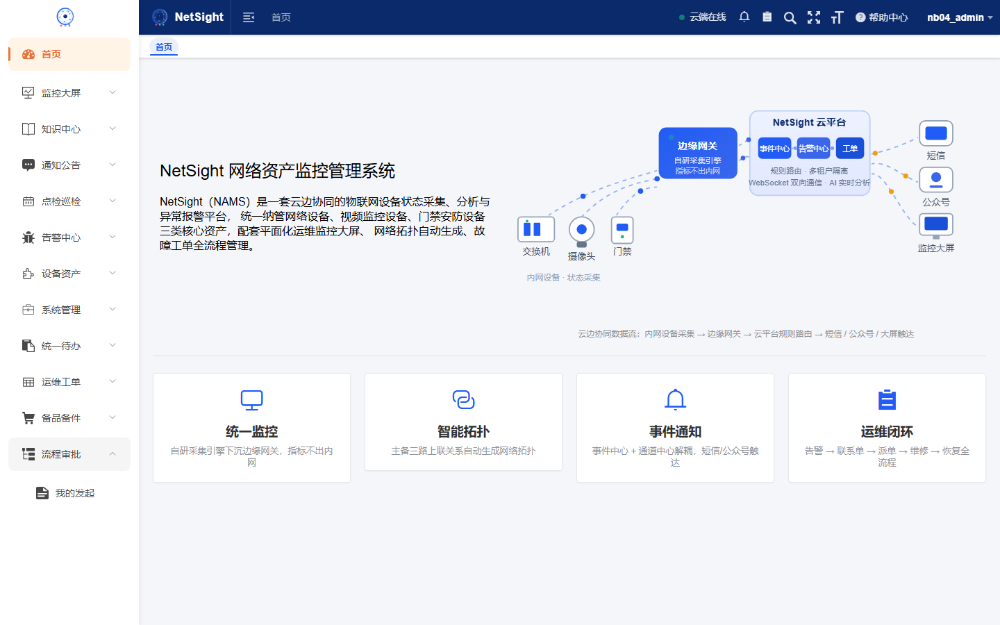
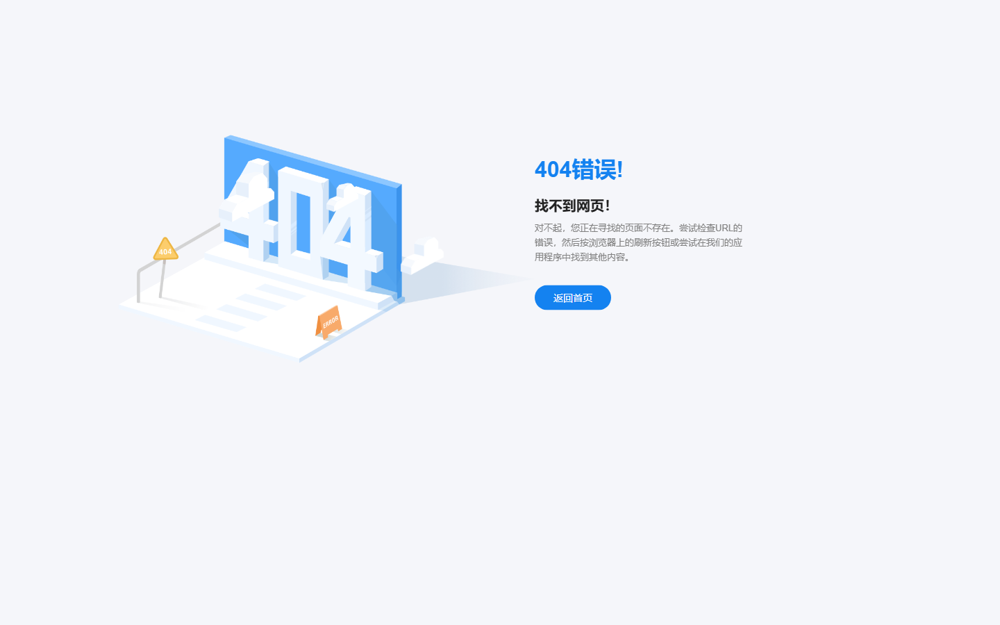
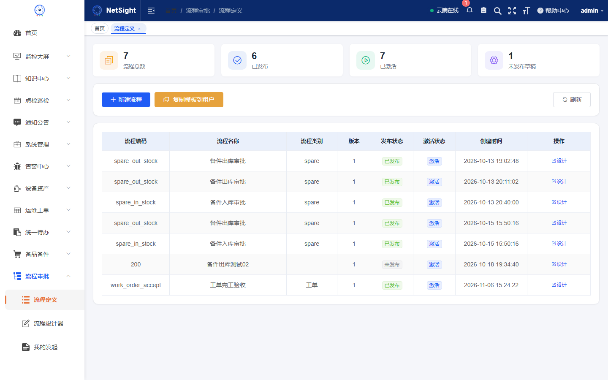

# NetSight 流程权限超管收敛测试与部署报告

- 日期：2026-11-20
- 方案：方案 B（后端接口校验 + 前端入口收敛 + 角色菜单调整）
- 环境：115 测试环境 `115.159.194.149`
- 分支：`feature/wechat-mp-full-support`
- 部署前 HEAD：`e49a484`
- 生产环境 `1.94.26.126` 未触碰

## 一、目标与结论

目标：审批流程只能由超级管理员创建、设计并复制到租户；租户管理员、运维人员只能使用“流程审批 / 我的发起”，侧边栏不再出现“流程定义”和“流程设计器”，并且不能通过直接调用引擎接口绕过。

结论：已按方案 B 完成编码、单元测试、生产构建、115 部署与接口/页面回归。

| 验证项 | 结果 |
|---|---|
| 匿名访问 `/warm-flow/query-def` | 401 |
| 租户管理员访问 `/warm-flow/query-def` | 403 |
| 租户管理员访问 `/warm-flow/handler-dict` | 403 |
| 租户管理员 POST `/warm-flow/save-json` | 403 |
| 运维人员访问 `/warm-flow/query-def` | 403 |
| 超级管理员访问 `/warm-flow/query-def` | HTTP 200，业务 `code=200` |
| 超级管理员访问 `/warm-flow/handler-dict` | HTTP 200，业务 `code=200` |
| 租户管理员侧边栏 | 仅“流程审批 / 我的发起” |
| 运维人员侧边栏 | 仅“流程审批 / 我的发起” |
| 超管侧边栏 | “流程定义 / 流程设计器 / 我的发起” |
| 租户直链 `/workflow/designer` | 404 |
| 超管“流程定义”页 | 显示“新建流程”“复制模板到租户”“设计” |
| 后端全量测试 | 22 套件、89 用例、0 失败、0 错误、0 跳过 |
| 前端生产构建 | `npm run build:prod` 成功 |

## 二、代码改动

### 1. 新增引擎接口访问控制

新增 `netsight-server/src/main/java/com/netsight/modules/workflow/security/WarmFlowAccessManager.java`。

规则：

1. 未登录或 principal 不是 `LoginUser`：拒绝。
2. `LoginUser.getIsSuperAdmin()` 不为 `true`：拒绝。
3. 仅超级管理员允许访问。

### 2. 收紧 SecurityConfig

修改 `netsight-server/src/main/java/com/netsight/config/SecurityConfig.java`：

- 从白名单移除 `"/warm-flow/**"`。
- 保留 `"/warm-flow-ui/**"`，用于设计器静态页面在 iframe 中加载。
- 新增 `.requestMatchers("/warm-flow/**").access(warmFlowAccessManager)`。

授权链顺序：

```java
.requestMatchers(HttpMethod.OPTIONS, "/**").permitAll()
.requestMatchers(WHITE_LIST).permitAll()
.requestMatchers("/warm-flow/**").access(warmFlowAccessManager)
.anyRequest().authenticated()
```

### 3. 前端按钮收敛

修改 `netsight-ui/src/views/workflow/definition/index.vue`：

- “新建流程”增加 `v-if="isSuperAdmin"`。
- 表格“操作”列增加 `v-if="isSuperAdmin"`，非超管不显示“设计”按钮。
- “复制模板到租户”原本已为超管专属。

### 4. 角色菜单 SQL

新增 `docs/sql/workflow-superadmin-only-20261120.sql`：

```sql
DELETE rp
FROM sys_role_permission rp
JOIN sys_role r ON r.id = rp.role_id
JOIN sys_permission p ON p.id = rp.permission_id
WHERE r.role_key IN ('tenant_admin', 'ops')
  AND p.perm_key IN ('workflow:definition:menu', 'workflow:designer:menu');
```

新增回滚脚本 `docs/sql/workflow-superadmin-only-20261120-rollback.sql`。

执行后实测：

| 角色 | 保留的流程权限 |
|---|---|
| `tenant_admin` | `workflow:menu`、`workflow:started:menu` |
| `ops` | `workflow:menu`、`workflow:started:menu` |
| `super_admin` | 无显式流程权限，按超管通配获得全部 |

## 三、部署记录

### 1. 备份

- 旧 jar：`/opt/nams-server/backups/netsight-server-20261120-065945.jar`
- 旧前端：`/opt/nams-ui/dist.old-20261120-065945`
- 权限表备份：`/opt/nams-server/backups/pre-workflow-superadmin-20261120-065945.sql`

说明：`mysqldump` 输出了 `PROCESS privilege` 警告，但备份文件已包含 `sys_role`、`sys_permission`、`sys_role_permission` 的建表与完整 `INSERT`，文件尾部为 `Dump completed`，可作为本次角色权限回滚依据。

### 2. 产物

- 后端 jar：`/opt/nams-server/netsight-server.jar`
- 前端：`/opt/nams-ui/dist`
- 后端 jar SHA256：`27751023ec0dbefc4b30cfbbdf1bfd27a7f984a420764f77eafb38ebb03908ba`
- 健康检查：`{"code":200,"data":{"service":"netsight-server","redis":"UP","status":"UP"}}`
- 新 PID：`1792342`
- 应用启动日志：`Started NetsightApplication in 11.51 seconds`

## 四、接口验证

### 1. 真实引擎接口

`WarmFlowController` 实际路由为 `/warm-flow/query-def`、`/warm-flow/handler-dict`、`/warm-flow/save-json` 等，不使用 `/warm-flow/definition/list`。

| 身份 | 请求 | HTTP | 业务结果 |
|---|---|---|---|
| 匿名 | `GET /prod-api/warm-flow/query-def` | 401 | 未登录 |
| 租户管理员 `15657477316` | `GET /prod-api/warm-flow/query-def` | 403 | 没有权限访问该资源 |
| 租户管理员 | `GET /prod-api/warm-flow/handler-dict` | 403 | 没有权限访问该资源 |
| 租户管理员 | `POST /prod-api/warm-flow/save-json` | 403 | 没有权限访问该资源 |
| 运维人员 `15700000001` | `GET /prod-api/warm-flow/query-def` | 403 | 没有权限访问该资源 |
| 超级管理员 `18667800006` | `GET /prod-api/warm-flow/query-def` | 200 | `code=200` |
| 超级管理员 | `GET /prod-api/warm-flow/handler-dict` | 200 | `code=200` |

结论：非超管在安全层被拦截，无法通过直接请求绕过前端。

### 2. 菜单接口

`GET /prod-api/getRouters` 实测：

- 租户管理员：`/workflow` → `/workflow/started`
- 运维人员：`/workflow` → `/workflow/started`
- 超级管理员：`/workflow` → `/workflow/definition`、`/workflow/designer`、`/workflow/started`

### 3. 静态页面边界

- 匿名 `GET /prod-api/warm-flow-ui/index.html`：200。

这是设计器静态壳页面，允许加载 iframe；其调用的 `/warm-flow/**` 数据接口已要求超管，匿名或非超管无法取得流程数据或保存流程。

## 五、页面级回归

使用本机 Chrome + Playwright，真实登录后操作。

### 租户管理员侧边栏



- 侧边栏只有“流程审批 / 我的发起”。
- 页面文本中 `流程定义=False`、`流程设计器=False`、`我的发起=True`。
- 直接访问 `/workflow/designer` 跳转 `/404`，页面显示“404错误! 找不到网页！”。



### 超级管理员流程定义页



- 侧边栏包含“流程定义 / 流程设计器 / 我的发起”。
- 页面按钮包含“新建流程”“复制模板到租户”；表格每行有“设计”。

## 六、测试与构建

- 新增 `WarmFlowAccessManagerTest`，覆盖匿名、`tenant_admin`、`ops`、`super_admin` 四类身份。
- 后端全量：22 个测试套件、89 个测试、0 失败、0 错误、0 跳过。
- 前端 `npm run build:prod` 成功，仅有项目原有包体积和 API 导出警告。
- 部署包：`C:\Users\Administrator\AppData\Local\Temp\netsight-dist-20261120.tar.gz`，3,605,277 bytes。

## 七、遗留观察

1. `/warm-flow-ui/**` 静态壳仍允许匿名加载，本次只保护数据接口；如需彻底禁止匿名打开设计器，可下一轮再收紧静态资源。
2. `/workflow/definitions` 仍允许已登录用户只读查询，本次未限制只读列表；不影响“非超管不能创建/设计”。
3. `WarmFlowSaveInterceptor` 目前未见 `WebMvcConfig.addInterceptors` 注册，设计器保存后的 `tenant_id` 回填未做写入级端到端验证，避免污染测试数据。
4. 本次未执行流程创建/保存写操作，创建能力以 `save-json` 的 403 拦截和超管菜单/按钮为准。

## 八、回滚

1. 恢复旧 jar：`/opt/nams-server/backups/netsight-server-20261120-065945.jar`。
2. 恢复旧前端：`/opt/nams-ui/dist.old-20261120-065945`。
3. 执行 `docs/sql/workflow-superadmin-only-20261120-rollback.sql`，恢复 `tenant_admin`、`ops` 的 156/157 权限。
4. 重启：`nohup bash /opt/nams-server/start.sh`。
